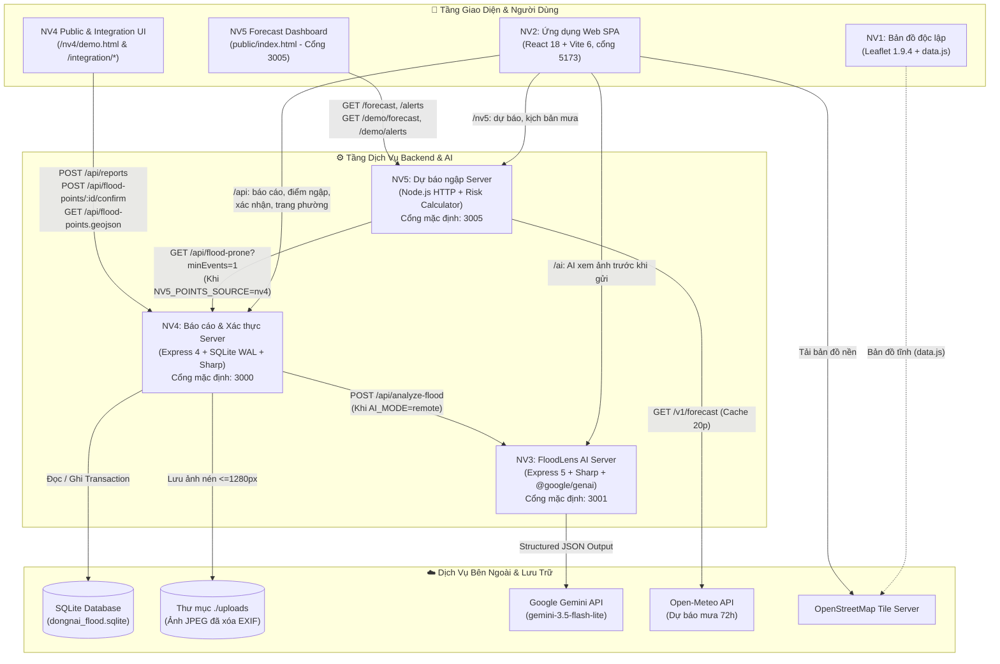
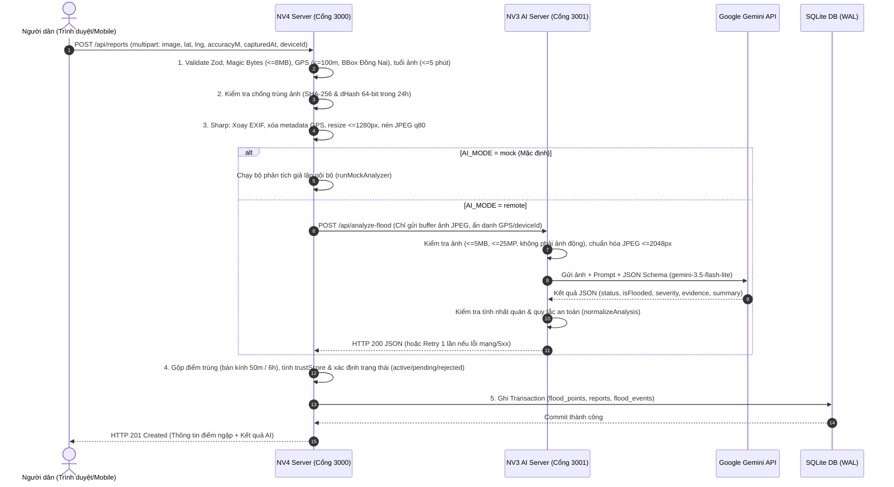

# 🌊 App Cảnh Báo Ngập Lụt Đồng Nai – Đấu Trường AI 2026

> **Chạy bản tích hợp (11/11/2026):** ở thư mục gốc chạy `npm install`, `npm run setup`, rồi `npm run dev` (hoặc `npm run dev:mock` khi chưa có key Gemini) và mở http://localhost:5173. Chi tiết, kịch bản demo và lỗi hay gặp: [docs/HUONG-DAN-CHAY.md](docs/HUONG-DAN-CHAY.md). Trong repo các phần nằm ở `frontend/` (NV2), `server/` (NV4), `backend/` (NV3), `nv5-forecast/` (NV5), `nv1-ban-do/` (NV1), `data/` (NV6).


> **Hệ thống hỗ trợ theo dõi điểm ngập, tiếp nhận phản ánh hiện trường từ người dân, phân tích hình ảnh ngập đường bằng AI (Google Gemini), xác thực cộng đồng và dự báo nguy cơ ngập theo lượng mưa tại thành phố Đồng Nai.**

[](https://nodejs.org/)
[](https://react.dev/)
[](https://vite.dev/)
[](https://leafletjs.com/)
[-003B57?logo=sqlite&logoColor=white)](https://www.sqlite.org/)
[](https://ai.google.dev/)

---

## 📑 Mục lục

1. [Giới thiệu dự án và mục tiêu](#1-giới-thiệu-dự-án-và-mục-tiêu)
2. [Hiện trạng tích hợp & Phân biệt các module](#2-hiện-trạng-tích-hợp--phân-biệt-các-module)
3. [Tổng hợp chức năng các nhiệm vụ (NV1 – NV5)](#3-tổng-hợp-chức-năng-các-nhiệm-vụ-nv1--nv5)
4. [Công nghệ thực tế được sử dụng](#4-công-nghệ-thực-tế-được-sử-dụng)
5. [Sơ đồ kiến trúc hệ thống (Mermaid)](#5-sơ-đồ-kiến-trúc-hệ-thống-mermaid)
6. [Cấu trúc thư mục thực tế](#6-cấu-trúc-thư-mục-thực-tế)
7. [Hướng dẫn clone, cài đặt và chạy dự án](#7-hướng-dẫn-clone-cài-đặt-và-chạy-dự-án)
8. [Cấu hình môi trường (`.env`)](#8-cấu-hình-môi-trường-env)
9. [Danh sách API Endpoints thực tế](#9-danh-sách-api-endpoints-thực-tế)
10. [Hướng dẫn kiểm thử và chạy Demo](#10-hướng-dẫn-kiểm-thử-và-chạy-demo)
11. [Phân công nhiệm vụ (NV1 – NV6)](#11-phân-công-nhiệm-vụ-nv1--nv6)
12. [Hạn chế hiện tại và hướng phát triển](#12-hạn-chế-hiện-tại-và-hướng-phát-triển)

---

## 1. Giới thiệu dự án và mục tiêu

**App Cảnh Báo Ngập Lụt Đồng Nai** là dự án được phát triển trong khuôn khổ **Gameshow Đấu trường AI thành phố Đồng Nai 2026**, hướng tới giải quyết bài toán theo dõi và cảnh báo sớm tình trạng ngập úng đô thị tại thành phố Đồng Nai (trọng tâm thử nghiệm tại khu vực Biên Hòa cũ và các phường lân cận, theo danh sách phường sau sắp xếp năm 2025).

### 🎯 Mục tiêu cốt lõi
- **Với người dân:**
  - Quan sát trực quan các điểm đang ngập và các vị trí/tuyến đường hay ngập trên bản đồ số.
  - Gửi báo cáo hiện trường nhanh bằng hình ảnh kèm tọa độ GPS ngay trên điện thoại.
  - Tham gia xác nhận tình trạng thực tế tại điểm ngập (*"Vẫn còn ngập"* / *"Đã hết ngập"*).
  - Xem thông tin cảnh báo sớm và dự báo nguy cơ ngập theo lượng mưa (đặc biệt trong khung giờ buổi tối 19:00–23:00 cho ngày hôm sau).
- **Với cán bộ quản lý cấp phường/xã:**
  - Tiếp nhận, đối chiếu kết quả phân tích từ AI, xác minh thông tin, yêu cầu bổ sung hoặc đóng/ẩn báo cáo và theo dõi thống kê theo địa bàn phường.
- **Về mặt kỹ thuật & An toàn thông tin:**
  - Kết hợp phân tích ảnh bằng mô hình thị giác máy tính **Google Gemini** (`@google/genai`) với quy tắc kiểm chứng địa lý, chống trùng lặp ảnh (`SHA-256` & `dHash`), tính điểm tin cậy cộng đồng (`trustScore`) và tự động quản lý vòng đời điểm ngập.
  - Minh bạch hóa nguồn dữ liệu: phân biệt rõ ràng giữa dữ liệu **Mô phỏng / Demo** và dữ liệu thực tế, không tự ý suy diễn thông tin an toàn giao thông khi chưa được kiểm chứng thực địa.

---

## 2. Hiện trạng tích hợp & Phân biệt các module

> [!IMPORTANT]
> Từ ngày 11/11/2026, code của 5 nhiệm vụ được gộp vào nhánh `tich-hop` (mỗi phần một thư mục) và chạy chung bằng `npm run dev` ở thư mục gốc. Giao diện NV2 gọi thẳng máy chủ NV3, NV4, NV5 qua proxy của Vite nên chỉ cần mở một địa chỉ `http://localhost:5173`.

| Phân hệ / Cặp kết nối | Trạng thái | Chi tiết kỹ thuật |
| :--- | :---: | :--- |
| **NV2 ↔ NV4** *(Giao diện ↔ Báo cáo)* | ✅ **Đã nối** | `frontend/src/services/liveApi.js` gọi `/api/...` của NV4 (cổng `3000`): bản đồ, gửi báo cáo, xác nhận vẫn ngập / hết ngập, trang phường (`POST /api/flood-points/:id/ward-action`). Bật bằng `VITE_DATA_MODE=live`, lệnh `npm run dev` đã đặt sẵn. |
| **NV2 ↔ NV3** *(Giao diện ↔ AI)* | ✅ **Đã nối** | Ở bước báo ngập, ảnh được gửi tới `/ai/api/analyze-flood` (NV3, cổng `3001`) để người dân xem AI nhận xét trước khi gửi. |
| **NV4 ↔ NV3** *(Báo cáo ↔ AI)* | ✅ **Đã nối** | NV4 (`src/services/aiAnalyzer.js`) gọi `POST /api/analyze-flood` của NV3 khi `AI_MODE=remote` (lệnh `npm run dev` đã đặt sẵn), thử lại 1 lần và chuyển `pending` khi lỗi. |
| **NV5 ↔ NV4** *(Dự báo ↔ Điểm hay ngập)* | ✅ **Đã nối** | NV5 (`src/adapters/floodPointsSource.js`) lấy điểm hay ngập từ `GET /api/flood-prone?minEvents=1` của NV4 khi `NV5_POINTS_SOURCE=nv4`, cache 10 phút. |
| **NV2 ↔ NV5** *(Giao diện ↔ Dự báo)* | ✅ **Đã nối** | Trang **Cảnh báo → Nguy cơ sắp tới** gọi `/nv5/forecast` (mưa Open-Meteo thật) hoặc `/nv5/demo/forecast` khi chọn kịch bản mưa mô phỏng trong **Tùy chọn**. |
| **NV6 → NV4** *(Dữ liệu)* | ✅ **Đã nạp** | `npm run setup` / `npm run reset-data` nạp 8 điểm của NV6 (`server/data/real/seed-flood-points.real.json`): 5 điểm từng ngập theo báo chí và 3 điểm đang ngập để trình diễn (nhãn *Mô phỏng*). Danh sách 14 phường sau sắp xếp nằm ở `data/wards.json`. |
| **NV1** *(Bản đồ Leaflet bản đầu)* | 🟡 **Trang riêng** | `nv1-ban-do/` giữ bản đồ tĩnh ban đầu (6 điểm mẫu trong `data.js`). Bản đồ chính của app nằm trong giao diện NV2, cũng dùng Leaflet. |

---

## 3. Tổng hợp chức năng các nhiệm vụ (NV1 – NV5)

### 🗺️ NV1 – Bản đồ số và hiển thị dữ liệu ngập (`nv1-ban-do/`)
- Khởi tạo bản đồ nền OpenStreetMap với thư viện **Leaflet 1.9.4** đặt tâm tại thành phố Đồng Nai (`[11.35, 107.05]`, zoom `9`).
- Phân loại hiển thị marker bằng màu sắc trực quan:
  - **Đang ngập (`current`):** Đỏ (`#e23c41` – ngập nặng), Cam (`#ee8d28` – ngập vừa), Vàng (`#e5c42e` – ngập nhẹ).
  - **Vị trí hay ngập (`frequent`):** Xanh dương (`#2776cb`) có viền nét đứt (`dashArray`).
- Hỗ trợ bảng điều khiển bật/tắt độc lập 2 lớp bản đồ (`L.layerGroup`): *"Đang ngập (mẫu)"* và *"Hay ngập (mẫu)"*.
- Hiển thị Popup an toàn (chống XSS bằng hàm `escapeHtml`) cung cấp: tên vị trí, mức độ ngập, tổng số lần ngập (`floodCount`), tọa độ, mô tả, hình ảnh minh họa và nhãn cảnh báo dữ liệu mô phỏng.

### 💻 NV2 – Giao diện Người dân & Khu vực Quản lý (`frontend/`)
- **Khu vực Người dân (`CitizenLayout`):**
  - **Bản đồ & Tra cứu (`/`, `/diem-ngap/:id`):** Xem điểm ngập công khai, lọc theo mức độ nghiêm trọng, khung thời gian (`6h`, `24h`, `7d`), khu vực và trạng thái xác minh; tìm kiếm địa điểm không dấu (`searchPlaces`).
  - **Gửi báo cáo hiện trường (`/bao-ngap`):** Chọn/chụp ảnh, tự động thu nhỏ cạnh dài về `1600px` bằng HTML5 Canvas (`downscalePhoto`), kiểm tra tọa độ trong vùng hỗ trợ, nhận kết quả phân tích AI từ NV3 (chế độ mẫu thì giả lập), lưu bản nháp tự động (`drafts.js`) và chống gửi trùng lặp bằng `requestId`.
  - **Xác nhận cộng đồng:** Gửi quan sát mới tại điểm ngập (*"Vẫn còn ngập"* kèm mức độ hoặc *"Nước đã rút"*).
  - **Cảnh báo & Dự báo (`/canh-bao`):** Xem danh sách cảnh báo theo khu vực và biểu đồ lượng mưa theo giờ.
  - **Tuyến đường bị ảnh hưởng (`/duong-bi-anh-huong`, `/tim-duong`):** Theo dõi danh sách tuyến đường ngập; màn hình tìm đường hiển thị trạng thái chờ tích hợp dịch vụ định tuyến (`routingEnabled: false`).
  - **Quản lý cá nhân (`/bao-cao-cua-toi`, `/bao-cao/:id`, `/tuy-chon`):** Theo dõi lịch sử xử lý báo cáo đã gửi, bổ sung thông tin/ảnh khi cán bộ yêu cầu (`addReportInfo`), chuyển đổi giao diện Sáng/Tối (Light/Dark theme) và bật/tắt **Công cụ trình diễn** (giả lập mất mạng, lỗi AI, timeout AI, lỗi tải tile bản đồ, khôi phục dữ liệu mẫu).
- **Khu vực Cán bộ Quản lý (`/quan-ly` - `AdminLayout`):**
  - Quản lý danh sách báo cáo có phân trang, tìm kiếm và bộ lọc đa chiều.
  - Thực hiện chuỗi hành động nghiệp vụ chặt chẽ (`allowedActions`): *Tiếp nhận (`receive`)*, *Yêu cầu bổ sung (`request-info`)*, *Xác nhận thông tin & công khai (`verify`)*, *Đánh dấu không hợp lệ (`invalid`)*, *Chuyển đang xử lý (`in-progress`)*, *Đóng báo cáo (`close`)*, *Ẩn khỏi bản đồ (`hide`)* và *Ghi chú phản hồi (`addAdminNote`)*.
  - Kiểm soát xung đột dữ liệu (Optimistic Concurrency Control) bằng trường `version` (`ConflictError`).
  - Xem bản đồ quản lý toàn địa bàn (`/quan-ly/ban-do`) và trạng thái các nguồn dữ liệu (`/quan-ly/nguon-du-lieu`).

### 🤖 NV3 – Dịch vụ AI phân tích ảnh ngập đường FloodLens (`backend/`)
- Cung cấp dịch vụ REST API độc lập nhận ảnh hiện trường qua `POST /api/analyze-flood` (`multipart/form-data`, trường `image`).
- **Tiền xử lý & Bảo mật hình ảnh nghiêm ngặt (`src/utils.js`):**
  - Giới hạn dung lượng tối đa **5 MiB** (`5.242.880` byte), chỉ nhận đúng 1 file, không nhận field phụ.
  - Dùng `sharp` giải mã thực tế để kiểm tra định dạng (`JPEG`, `PNG`, `WebP`), từ chối ảnh giả mạo MIME, ảnh hỏng, ảnh động (`pages > 1`) hoặc ảnh vượt quá **25 triệu pixel**.
  - Tự động xoay ảnh theo hướng EXIF, thu nhỏ cạnh dài tối đa **2048px**, chuyển đổi sang JPEG chất lượng 85 và xóa toàn bộ metadata cá nhân trước khi gửi AI. Xử lý hoàn toàn trên RAM (`multer.memoryStorage()`).
- **Tích hợp Google Gemini (`src/gemini.js`):**
  - Sử dụng SDK `@google/genai` (mặc định model `gemini-3.5-flash-lite`) với cấu hình **Structured JSON Output** (`responseJsonSchema`) và `temperature: 0.1`.
  - Hỗ trợ chế độ `MOCK_GEMINI=true` phục vụ kiểm thử HTTP không cần khóa API.
- **Chuẩn hóa & Kiểm soát an toàn kết quả (`normalizeAnalysis`):**
  - Kiểm tra tính nhất quán giữa `status` (`flooded` / `not_flooded` / `uncertain`), `isFlooded` và `severity` (`none` / `low` / `medium` / `high` / `unknown`).
  - Tự động hạ kết quả về `uncertain` nếu thiếu bằng chứng (`evidence`) hoặc nếu nội dung trả về vi phạm quy tắc an toàn (chứa cam kết tuyến đường an toàn, suy đoán độ sâu cm/m chính xác...). Luôn gắn `needsVerification: true`.
- Cung cấp trang giao diện kiểm thử trực quan tại `GET /test`.

### 🛡️ NV4 – Backend Tiếp nhận Báo cáo, Xác thực Cộng đồng & Quản lý Điểm ngập (`server/`)
- **Kiến trúc phân tầng (Layered Architecture):** Tách biệt rõ `routes` → `controllers` → `services` → `domain` (100% pure functions dễ kiểm thử) → `repositories` (SQLite WAL).
- **Quy trình tiếp nhận & Xác thực báo cáo (`POST /api/reports`):**
  1. Kiểm tra dữ liệu đầu vào bằng `Zod` và kiểm tra chữ ký nhị phân (**Magic Bytes**) của ảnh JPEG/PNG/WebP (tối đa 8 MB).
  2. Kiểm tra điều kiện địa lý & thời gian (`src/config/rules.js`): Tọa độ phải nằm trong Bounding Box thành phố Đồng Nai (`Lat: 10.35–11.60`, `Lng: 106.75–107.60`), sai số GPS $\le 100\text{m}$, thời điểm chụp ảnh không cũ quá **5 phút** và không lệch tương lai quá 1 phút.
  3. Chống ảnh trùng lặp bằng mã băm **SHA-256** tuyệt đối và thuật toán băm cảm nhận thị giác **dHash 64-bit** (khoảng cách Hamming $\le 5$ trong vòng 24 giờ).
  4. Xử lý ảnh qua `sharp` (giới hạn 50M pixels chống decompression bomb, xóa sạch EXIF/GPS, thu nhỏ $\le 1280\text{px}$, nén JPEG `q80`).
  5. Gọi dịch vụ AI (`mock` hoặc `remote` sang NV3 cổng `3001`), ánh xạ qua `aiContract.js`.
  6. **Gộp điểm ngập trùng lặp (Deduplication):** Tự động gộp các báo cáo trong bán kính **50m** và cửa sổ **6 giờ** vào cùng một điểm ngập (`flood_points`), tính điểm tin cậy `trustScore` (thang 0–100) và mở/cập nhật sự kiện ngập (`flood_events`).
- **Xác nhận cộng đồng & Vòng đời tự động:**
  - Người dân trong bán kính $\le 300\text{m}$ có thể gửi xác nhận `still` hoặc `ended` (`POST /api/flood-points/:id/confirm`). Khi có đủ **2 thiết bị khác nhau** báo `ended`, điểm ngập tự động chuyển sang `resolved` và tăng bộ đếm lịch sử ngập (`floodEventCount`).
  - Tiến trình chạy nền (`expirationService.js`) quét mỗi 5 phút để tự động chuyển các điểm không có tương tác sau **6 giờ** sang trạng thái `expired`.
- **Cung cấp dữ liệu đa định dạng & Frontend nhúng:**
  - Xuất danh sách điểm ngập chuẩn **GeoJSON FeatureCollection** (`GET /api/flood-points.geojson`, hỗ trợ `ETag` & HTTP `304`), danh sách cụm đường hay ngập (`GET /api/flood-prone`) và thống kê theo phường/xã (`GET /api/wards/:wardId/flood-points`).
  - Cung cấp bộ thư viện giao diện Vanilla JS sẵn sàng nhúng (`public/nv4/`: `reportFlow.js`, `confirmWidget.js`, `camera.js`, `geo.js`).

### 🌧️ NV5 – Dự báo nguy cơ ngập theo lượng mưa & Cảnh báo sớm (`nv5-forecast/`)
- Module độc lập hoàn toàn (zero external dependencies, sử dụng `node:http` thuần của Node.js $\ge 18$).
- **Thu thập dữ liệu mưa thực tế (`src/openMeteoClient.js`):**
  - Tích hợp API thời tiết **Open-Meteo** (`https://api.open-meteo.com/v1/forecast`) lấy dữ liệu lượng mưa (`precipitation`) và xác suất mưa (`precipitation_probability`) theo giờ trong 3 ngày theo múi giờ `Asia/Ho_Chi_Minh`, có bộ nhớ đệm (cache) 20 phút và timeout 8 giây.
  - Giữ nguyên giá trị `null` khi thiếu dữ liệu (không tự quy đổi `null` thành `0 mm` để tránh báo an toàn giả).
- **Mô hình tính toán nguy cơ (`src/riskCalculator.js`):**
  - Tính tổng lượng mưa trượt (rolling sum) trong các cửa sổ **1 giờ, 3 giờ và 6 giờ**.
  - Phân loại mức nguy cơ dựa trên lượng mưa tích lũy 3 giờ kết hợp lịch sử số lần ngập (`so_lan_ngap`):
    - **Thấp (`thap`):** $< 15\text{ mm}/3\text{h}$
    - **Trung bình (`trung_binh`):** $\ge 15\text{ mm}/3\text{h}$
    - **Cao (`cao`):** $\ge 30\text{ mm}/3\text{h}$
    - **Rất cao (`rat_cao`):** $\ge 50\text{ mm}/3\text{h}$ **và** điểm đã có lịch sử ngập $\ge 3$ lần.
  - Tự động gộp các khung giờ nguy cơ liên tiếp hoặc chồng lấn thành các khoảng cảnh báo (`mergeIntervals`).
- **Bộ lập lịch cảnh báo buổi tối (`src/alertScheduler.js`):**
  - Phát cảnh báo sớm cho **ngày mai** trong khung giờ buổi tối **19:00 – 23:00** (giờ Việt Nam), có cơ chế chống trùng lặp bản tin (`dedupStore`) và hỗ trợ cờ `simulate=19` để kiểm thử ngoài khung giờ.
- **Chế độ mô phỏng kịch bản mưa lớn (`src/demoScenarios.js`):**
  - Cung cấp 3 kịch bản mưa giả định (*Trung bình 20mm/3h*, *Cao 36mm/3h*, *Rất cao 60mm/3h + 3 lần ngập*) tách biệt hoàn toàn với dữ liệu Open-Meteo để phục vụ trình diễn.

---

## 4. Công nghệ thực tế được sử dụng

Dưới đây là danh mục công nghệ và thư viện thực tế được trích xuất trực tiếp từ các tệp `package.json` và mã nguồn của 5 phân hệ:

| Phân hệ | Ngôn ngữ & Kiểu Module | Framework / Thư viện chính | CSDL / Lưu trữ | Công cụ Kiểm thử & Build |
| :--- | :--- | :--- | :--- | :--- |
| **NV1** (`nv1-ban-do`) | HTML5, CSS3, Vanilla JS | **Leaflet `1.9.4`** (qua CDN jsDelivr), OpenStreetMap Tiles | Mảng dữ liệu tĩnh trong `data.js` | Chạy trực tiếp trên trình duyệt |
| **NV2** (`frontend`) | JavaScript ES Modules (`JSX`) | **React `^18.3.1`**, **React DOM `^18.3.1`**, **React Router DOM `^6.28.0`**, **Leaflet `^1.9.4`**, CSS thuần + Font *Be Vietnam Pro* | Gọi API NV3/NV4/NV5 qua proxy Vite (`liveApi.js`); chế độ mẫu dùng **IndexedDB** & **localStorage** | **Vite `^6.0.1`**, `@vitejs/plugin-react` `^4.3.3` |
| **NV3** (`backend`) | Node.js $\ge 20.9.0$ (`ES Modules`) | **Express `5.3.0`**, **`@google/genai` `2.32.0`**, **Multer `2.5.0`**, **Sharp `0.35.5`**, **CORS `2.8.6`**, **Dotenv `18.0.10`** | Xử lý ảnh trên RAM (`MemoryStorage`), không lưu đĩa | `node --test` (Node built-in test runner) |
| **NV4** (`server`) | Node.js (`ES Modules`) | **Express `^4.21.2`**, **Zod `^3.24.2`**, **Multer `^1.4.5-lts.1`**, **Sharp `^0.33.5`**, **Express Rate Limit `^7.5.0`**, **CORS `^2.8.5`**, **Dotenv `^16.4.7`** | **SQLite 3** (`better-sqlite3` `^13.0.3`, chế độ `WAL`) + Lưu ảnh tại `./uploads` | **Vitest `^3.0.7`**, **Supertest `^7.0.0`** |
| **NV5** (`nv5-forecast`) | Node.js $\ge 18$ (`CommonJS`) | Thuần Node.js built-in (`node:http`, `node:fs/promises`, `globalThis.fetch`), kết nối **Open-Meteo API** | Bộ nhớ đệm trên RAM (`Map`) + File `data/flood-points.sample.json` | `node --test` (Node built-in test runner) |

---

## 5. Sơ đồ kiến trúc hệ thống (Mermaid)

### 5.1. Kiến trúc tổng thể và luồng tích hợp giữa các phân hệ

> *Ghi chú: Nét liền (`-->`) là luồng đã kết nối trong code ở nhánh `tich-hop`; nét đứt (`-.->`) là trang mẫu chạy riêng.*



### 5.2. Luồng xử lý báo cáo ngập và phân tích AI (NV2/Client → NV4 → NV3)



---

## 6. Cấu trúc thư mục thực tế

Nhánh `tich-hop` gộp code của 5 nhiệm vụ vào một repo, mỗi phần một thư mục:

```text
DauTruongAI_App-chong-ngap-lut/
├── package.json                 # Lệnh chạy chung: setup, dev, dev:mock, test, reset-data, tunnel
├── README.md                    # Tài liệu tổng hợp (file hiện tại)
├── scripts/reset-data.js        # Xóa database NV4 rồi nạp lại dữ liệu NV6
├── docs/                        # NV6: HUONG-DAN-CHAY.md, ghi chú phường mới, bảng ảnh test cho NV3
├── data/                        # NV6: diem-ngap.json, seed-flood-points.real.json, wards.json
│
├── nv1-ban-do/                  # NV1 (nhánh nv1-ban-do-va-hien-thi-du-lieu): bản đồ Leaflet tĩnh
│   ├── index.html, main.js, style.css
│   ├── data.js                  # 6 điểm ngập mẫu
│   └── assets/anh-minh-hoa.svg
│
├── frontend/                    # NV2 (nhánh nv2-frontend-ui): React 18 + Vite 6 + Leaflet, cổng 5173
│   ├── vite.config.js           # Proxy /api, /uploads → 3000; /ai → 3001; /nv5 → 3005
│   └── src/
│       ├── app/                 # App.jsx (Routes), CitizenLayout.jsx, config.js
│       ├── components/ui/       # Button, Dialog, Badge, Feedback...
│       ├── data/                # wards.json (phường mới), mock/ (dữ liệu mẫu)
│       ├── features/            # admin, alerts, auth, map, report, roads, settings
│       ├── services/            # api.js (mặt tiền, chế độ mẫu), liveApi.js (gọi máy chủ thật), storage.js, drafts.js
│       └── styles/
│
├── backend/                     # NV3 (nhánh feat/nv3-ai-backend): AI Gemini, cổng 3001
│   ├── .env.example             # GEMINI_API_KEY, GEMINI_MODEL, MOCK_GEMINI...
│   ├── public/test.html         # Trang thử phân tích ảnh
│   ├── scripts/                 # check.js, start-mock.js, live-smoke.js
│   ├── src/                     # server.js, app.js, config.js, gemini.js, utils.js
│   └── tests/                   # 24 test
│
├── server/                      # NV4 (nhánh nv4-bao-cao-va-xac-thuc): Express + SQLite, cổng 3000
│   ├── data/demo/, data/real/   # Dữ liệu mẫu và dữ liệu NV6
│   ├── docs/                    # API.md, INTEGRATION.md, TEST_CASES.csv, MOBILE_TEST.md...
│   ├── integration/             # Mã mẫu tích hợp cho NV1, NV2, NV5
│   ├── public/nv4/              # Trang demo gửi báo cáo và xác nhận
│   ├── scripts/                 # migrate.js, seed.js (--real), seedClear.js, demo-reset.js, e2e.js, verify.js
│   ├── src/
│   │   ├── config/              # env.js, rules.js (ngưỡng nghiệp vụ)
│   │   ├── controllers/         # report, floodPoint, confirmation, wardAction
│   │   ├── domain/              # geo, dedupe, lifecycle, trustScore, imageHash, aiContract
│   │   ├── repositories/        # floodPointRepo, reportRepo, eventRepo, confirmationRepo
│   │   ├── routes/, middleware/, utils/
│   │   └── services/            # reportService, aiAnalyzer, confirmationService, wardActionService...
│   └── tests/                   # 22 file, 208 test
│
└── nv5-forecast/                # NV5 (nhánh nv5-du-bao-ngap): dự báo mưa, cổng 3005
    ├── api/routes.js            # /forecast, /alerts, /demo/*
    ├── public/                  # Trang xem dự báo riêng của NV5
    ├── src/                     # openMeteoClient, riskCalculator, alertScheduler, demoScenarios, adapters/
    └── tests/                   # 21 test
```

---

## 7. Hướng dẫn clone, cài đặt và chạy dự án

### Yêu cầu hệ thống
- **Node.js** 20 hoặc 22 (bản LTS) và **Git**.
- Trình duyệt Chrome hoặc Edge.
- Internet để tải bản đồ nền OpenStreetMap, gọi Gemini (NV3) và Open-Meteo (NV5).

### 7.1. Chạy cả app (khuyên dùng)

```powershell
git clone https://github.com/trucnhttruc2112-ship-it/DauTruongAI_App-chong-ngap-lut.git
cd DauTruongAI_App-chong-ngap-lut
git checkout tich-hop      # bỏ qua khi nhánh này đã gộp vào main
npm install
npm run setup              # cài thư viện từng phần, tạo database, nạp dữ liệu NV6
npm run dev                # AI thật: cần backend/.env có GEMINI_API_KEY
npm run dev:mock           # hoặc AI giả lập, không cần key
```

Mở `http://localhost:5173`. Tài khoản thử: `nguoidan` (người dân) và `quanly` (phường), mật khẩu bất kỳ từ 6 ký tự. Kịch bản demo, cách mở trên điện thoại và lỗi hay gặp: [docs/HUONG-DAN-CHAY.md](docs/HUONG-DAN-CHAY.md).

| Lệnh (ở thư mục gốc) | Việc làm |
| :--- | :--- |
| `npm run setup` | Cài thư viện cho `backend`, `server`, `frontend`; tạo database; nạp dữ liệu NV6 |
| `npm run dev` | Chạy cùng lúc AI (3001), báo cáo (3000), dự báo (3005), giao diện (5173) |
| `npm run dev:mock` | Như trên nhưng AI giả lập |
| `npm run reset-data` | Xóa báo cáo thử, nạp lại dữ liệu ban đầu (tắt app trước) |
| `npm run tunnel` | Tạo link `https` tạm thời để điện thoại dùng được camera và GPS |
| `npm test` | Chạy test của NV3, NV4, NV5 |

---

### 7.2. Cài đặt và chạy từng phân hệ độc lập

#### 🔹 1. Chạy NV1 (Bản đồ Leaflet tĩnh)
Không cần cài đặt thư viện Node.js.
- Mở trực tiếp tệp `nv1-ban-do/index.html` bằng trình duyệt Chrome/Edge, hoặc sử dụng tiện ích **Live Server** trong VS Code.

#### 🔹 2. Chạy NV2 (Ứng dụng Frontend React)
```powershell
cd frontend
npm install
npm run dev
```
- Mở `http://localhost:5173`. Chạy riêng thì giao diện dùng dữ liệu mẫu trên trình duyệt (`dataMode: 'demo'`); đặt `VITE_DATA_MODE=live` để gọi máy chủ thật.
- Các lệnh khác trong `package.json`:
  - `npm run build`: Đóng gói bản production vào thư mục `dist/`.
  - `npm run preview`: Xem thử bản build production.

#### 🔹 3. Chạy NV3 (Dịch vụ AI phân tích ảnh ngập – Cổng `3001`)
```powershell
cd backend
npm ci
Copy-Item .env.example .env
```
- **Chạy với chế độ Mock (không cần Gemini API Key):**
  ```powershell
  npm run start:mock
  ```
- **Chạy với Google Gemini thật:** Điền `GEMINI_API_KEY` vào tệp `backend/.env`, sau đó chạy:
  ```powershell
  npm start
  # Hoặc chạy chế độ tự động tải lại khi sửa code:
  npm run dev
  ```
- Truy cập trang kiểm thử trực quan: `http://localhost:3001/test`
- Kiểm tra trạng thái dịch vụ: `http://localhost:3001/api/health`

#### 🔹 4. Chạy NV4 (Backend Báo cáo ngập & Xác thực – Cổng `3000`)
```powershell
cd server
npm install
Copy-Item .env.example .env

# Khởi tạo bảng cơ sở dữ liệu SQLite
npm run migrate

# Nạp 20 điểm ngập mẫu tại Đồng Nai
npm run seed

# Khởi chạy server phát triển (hoặc dùng npm start)
npm run dev
```
- Máy chủ chạy tại: `http://localhost:3000`
- Giao diện Demo gửi báo cáo & xác nhận của NV4: `http://localhost:3000/nv4/demo.html`
- Bản đồ Leaflet tích hợp API GeoJSON mẫu: `http://localhost:3000/integration/nv1-leaflet-example.html`

#### 🔹 5. Chạy NV5 (Mô hình Dự báo ngập theo lượng mưa – Cổng `3005`)
```powershell
cd nv5-forecast

# Chạy độc lập với tệp dữ liệu mẫu data/flood-points.sample.json
npm start

# Hoặc chạy kèm cờ bật chế độ mô phỏng kịch bản mưa lớn
npm run demo
```
- Mở trình duyệt tại: `http://localhost:3005`

---

### 7.3. Chạy kết nối liên thông

Lệnh `npm run dev` ở thư mục gốc đã làm thay việc mở 4 cửa sổ: đặt `AI_MODE=remote` cho NV4, `NV5_POINTS_SOURCE=nv4` cho NV5 và `VITE_DATA_MODE=live` cho giao diện (xem `package.json` ở thư mục gốc).

---

## 8. Cấu hình môi trường (`.env`)

> [!CAUTION]
> Tuyệt đối không commit tệp `.env` hoặc khóa `GEMINI_API_KEY` lên Git. Chỉ sao chép từ tệp `.env.example` trên máy cục bộ.

Khi chạy bằng `npm run dev`, các biến kết nối (`AI_MODE`, `AI_ANALYZE_URL`, `RATE_LIMIT_PER_MINUTE`, `NV5_POINTS_SOURCE`, `NV4_API_URL`, `VITE_DATA_MODE`) đã được đặt trong `package.json` ở thư mục gốc. Chỉ cần tạo `backend/.env` có `GEMINI_API_KEY` khi muốn AI chạy thật.

### 8.1. Biến môi trường của NV3 (`backend/.env`)

| Tên biến | Mặc định trong code | Mẫu `.env.example` | Mô tả chi tiết |
| :--- | :--- | :--- | :--- |
| `GEMINI_API_KEY` | `""` (rỗng) | *(để trống)* | Khóa API lấy từ Google AI Studio. Bắt buộc khi `MOCK_GEMINI=false`. |
| `GEMINI_MODEL` | `gemini-3.5-flash-lite` | `gemini-3.5-flash-lite` | Tên model Gemini hỗ trợ xử lý ảnh và Structured JSON Output. |
| `PORT` | `3001` | `3001` | Cổng lắng nghe HTTP của dịch vụ NV3 (`1` – `65535`). |
| `ALLOWED_ORIGINS` | `http://localhost:5173,http://localhost:3000` | `http://localhost:5173,http://localhost:3000` | Danh sách các HTTP(S) Origin được phép gọi CORS, phân tách bằng dấu phẩy. |
| `MOCK_GEMINI` | `false` | `false` | Đặt `true` để trả kết quả giả lập (`status: "uncertain"`, `mode: "mock"`) mà không gọi Google. |
| `GEMINI_TIMEOUT_MS` | `30000` | `60000` | Thời gian chờ tối đa cho 1 yêu cầu gọi Gemini (`1` – `120000` ms). |

### 8.2. Biến môi trường của NV4 (`server/.env`)

| Tên biến | Mặc định trong code | Mô tả chi tiết |
| :--- | :--- | :--- |
| `NODE_ENV` | `development` | Môi trường chạy (`development`, `test`, `production`). |
| `PORT` | `3000` | Cổng HTTP của máy chủ NV4. |
| `DB_PATH` | `./data/dongnai_flood.sqlite` | Đường dẫn tệp cơ sở dữ liệu SQLite (tự động dùng `:memory:` khi `NODE_ENV=test`). |
| `UPLOAD_DIR` | `./uploads` | Thư mục lưu trữ ảnh báo cáo sau khi nén. |
| `DATA_MODE` | `demo` | Chế độ dữ liệu: `demo` (cho phép dữ liệu mẫu) hoặc `real` (cấm dữ liệu mẫu và cấm `AI_MODE=mock`). |
| `AI_MODE` | `mock` | Chế độ phân tích ảnh: `mock` (giả lập nội bộ) hoặc `remote` (gọi sang server NV3). |
| `AI_ANALYZE_URL` | `http://localhost:3001/api/analyze-flood` | Endpoint nhận ảnh phân tích của NV3 khi `AI_MODE=remote`. |
| `AI_API_KEY` | `""` | Khóa gửi kèm trong header `X-API-Key` sang NV3 (nếu có). |
| `AI_TIMEOUT_MS` | `20000` | Thời gian chờ phản hồi từ NV3 (ms) trước khi hủy request. |
| `PUBLIC_BASE_URL` | `http://localhost:3000` | URL gốc dùng để ghép đường dẫn ảnh tuyệt đối trả về cho client. |
| `ALLOWED_ORIGINS` | `http://localhost:3000,http://127.0.0.1:3000` | Danh sách Origin được phép qua CORS (bắt buộc khai báo khi `NODE_ENV=production`). |
| `TRUST_PROXY` | `loopback` (dev) / `false` (prod) | Cấu hình `trust proxy` cho Express (`true`, `false`, số hop, `loopback` hoặc dải IP/CIDR). |
| `ALLOW_DEMO_IN_PROD` | `false` | Cờ cho phép chạy `DATA_MODE=demo` hoặc `AI_MODE=mock` khi `NODE_ENV=production` (chỉ bật khi thử nghiệm có chủ đích). |
| `RATE_LIMIT_PER_MINUTE` | `20` | Số request tối đa mỗi phút cho mỗi IP. Chạy qua proxy Vite thì mọi người dùng chung 1 IP nên `npm run dev` đặt `300`. |

### 8.3. Biến môi trường của NV5 (`nv5-forecast`)

`NV5` đọc trực tiếp từ biến môi trường của tiến trình (`process.env`) mà không cần thư viện `dotenv`:

| Tên biến | Mặc định | Mô tả chi tiết |
| :--- | :--- | :--- |
| `PORT` | `3005` | Cổng HTTP của máy chủ dự báo NV5. |
| `NV5_POINTS_SOURCE` | `json` | Nguồn lấy danh sách điểm ngập: `json` (đọc `data/flood-points.sample.json`) hoặc `nv4` (gọi API của NV4). |
| `NV4_API_URL` | `http://localhost:3000` | Địa chỉ máy chủ NV4 khi `NV5_POINTS_SOURCE=nv4`. |
| `NV4_FALLBACK_JSON` | *(tắt)* | Đặt bằng `"1"` nếu muốn tự động chuyển về đọc JSON mẫu khi mất kết nối tới NV4. |
| `NV5_DEMO` | *(tự động ở localhost)* | Đặt bằng `"1"` để bật các endpoint mô phỏng kịch bản mưa (`/demo/*`) ngoài `NODE_ENV=production`. |

---

## 9. Danh sách API Endpoints thực tế

### 9.1. Dịch vụ AI phân tích ảnh – NV3 (Mặc định cổng `3001`)

| Phương thức | Đường dẫn | Đầu vào / Tham số | Mô tả & Phản hồi thực tế |
| :---: | :--- | :--- | :--- |
| `GET` | `/api/health` | Không | Kiểm tra trạng thái cấu hình dịch vụ (`status: "ok"`, `service: "floodlens-nv3"`, `mode`, `gemini.configured`, `analysisReady`). Không gọi Google API. |
| `POST` | `/api/analyze-flood` | `multipart/form-data` với duy nhất 1 trường file `image` (JPEG/PNG/WebP tĩnh, $\le 5\text{ MiB}$, $\le 25\text{ MP}$) | Phân tích ảnh ngập đường qua Gemini hoặc Mock. Trả về HTTP `200` với 9 trường: `isFlooded` (`boolean\|null`), `status` (`flooded\|not_flooded\|uncertain`), `severity` (`none\|low\|medium\|high\|unknown`), `evidence` (`string[]`), `summary` (`string`), `needsVerification` (`true`), `analyzedAt`, `model`, `mode`. |
| `GET` | `/test` | Không | Trang giao diện HTML độc lập để chọn ảnh, xem trước và kiểm thử trực tiếp API `/api/analyze-flood`. |

### 9.2. Dịch vụ Báo cáo ngập & Xác thực – NV4 (Mặc định cổng `3000`)

Mọi phản hồi JSON từ NV4 (trừ endpoint `.geojson`) đều được bọc theo chuẩn `{ "ok": true, "data": ... }` hoặc `{ "ok": false, "error": { "code", "message" } }`.

| Phương thức | Đường dẫn | Tham số Query / Body chính | Mô tả & Quy tắc nghiệp vụ |
| :---: | :--- | :--- | :--- |
| `GET` | `/api/health` | Không | Trả về trạng thái máy chủ (`status: "up"`), thời gian, tổng số điểm ngập (`pointsCount`), `aiMode` và `dataMode`. |
| `POST` | `/api/reports` | `multipart/form-data`: `image` (bắt buộc, $\le 8\text{MB}$), `lat`, `lng`, `accuracyM` ($\le 100$), `capturedAt` ($\le 5$ phút), `deviceId` (UUID), `source` (`camera\|gallery\|manual-pin`), `photoSource` (`camera\|library`, tùy chọn), `address` (mô tả vị trí, $\le 200$ ký tự), `note` ($\le 200$ ký tự) | Tiếp nhận báo cáo ngập từ người dân. Giới hạn **5 báo cáo/giờ/deviceId** và **20 requests/phút/IP**. Kiểm tra tọa độ Đồng Nai, chống trùng ảnh, nén ảnh xóa EXIF, gọi AI và tự động gộp điểm trong bán kính 50m / 6h. |
| `GET` | `/api/flood-points` | Query tùy chọn: `status` (mặc định `active`), `wardId`, `severity` (`low\|medium\|high`), `isFloodProne` (`true\|false`), `limit` ($\le 1000$), `bbox` (`minLng,minLat,maxLng,maxLat`) | Lấy danh sách điểm ngập dạng mảng đối tượng JSON phẳng, sắp xếp theo thời gian cập nhật mới nhất. |
| `GET` | `/api/flood-points.geojson` | Query giống `/api/flood-points` | Xuất dữ liệu chuẩn **GeoJSON `FeatureCollection`** (tọa độ `[lng, lat]`) phục vụ vẽ trực tiếp lên Leaflet. Hỗ trợ `Cache-Control: public, max-age=10` và `ETag` (`304 Not Modified`). |
| `GET` | `/api/flood-points/:id` | URL Param: `:id` | Xem chi tiết một điểm ngập kèm danh sách đường dẫn ảnh (`images`), mô tả AI (`aiDescription`), kết quả AI mới nhất (`latestAi`), nguồn ảnh/vị trí của báo cáo mới nhất (`latestReport`), trạng thái xử lý của phường (`processingStatus`, `history`, `version`) và lịch sử các đợt ngập (`events`). Trường `dataMode` cho biết điểm là `real` hay `demo` (mô phỏng). |
| `POST` | `/api/flood-points/:id/ward-action` | JSON Body: `action` (`receive\|request-info\|verify\|invalid\|in-progress\|close\|hide\|confirm-clear\|confirm-active\|note\|add-info`), `version`, `reason` (bắt buộc với `request-info`, `invalid`, `hide`, `note`), `closeOutcome`, `actor` | Thao tác của trang phường. Sai `version` trả `409` kèm dữ liệu mới nhất để giao diện báo xung đột. Mỗi thao tác ghi vào `history`. |
| `POST` | `/api/flood-points/:id/confirm` | JSON Body: `type` (`still\|ended`), `deviceId`, `lat`, `lng` | Người dân trong bán kính $\le 300\text{m}$ xác nhận tình trạng ngập. Giới hạn 10 req/phút/IP. Đủ 2 thiết bị báo `ended` sẽ chuyển điểm sang `resolved`. |
| `GET` | `/api/flood-prone` | Query: `minEvents` (mặc định `3`), `wardId` | Danh sách các cụm tuyến đường/vị trí hay ngập kèm tọa độ tâm (`centerLat`, `centerLng`), tổng số đợt ngập (`eventCount`) và mức độ trung bình (`avgSeverity`). |
| `GET` | `/api/wards/:wardId/flood-points` | URL Param: `:wardId` (VD: `long-binh`) | Thống kê tổng quan (`activeCount`, `proneCount`, `totalEvents`) và danh sách điểm ngập gom nhóm theo từng tuyến đường trong phường. |

### 9.3. Dịch vụ Dự báo ngập theo lượng mưa – NV5 (Mặc định cổng `3005`)

| Phương thức | Đường dẫn | Tham số Query | Mô tả & Phản hồi thực tế |
| :---: | :--- | :--- | :--- |
| `GET` | `/forecast` | Tùy chọn: `lat`, `lng`, `so_lan` (thêm 1 điểm thử nghiệm vào danh sách) | Lấy dữ liệu mưa theo giờ từ Open-Meteo, tính lượng mưa tích lũy `1h`/`3h`/`6h`, phân loại nguy cơ (`thap`, `trung_binh`, `cao`, `rat_cao`, `khong_du_du_lieu`) và gộp các khoảng giờ cảnh báo cho từng điểm ngập. |
| `GET` | `/alerts` | Tùy chọn: `lat`, `lng`, `so_lan`, `simulate=19` | Kiểm tra và sinh bản tin cảnh báo sớm cho **ngày mai** nếu thời điểm hiện tại nằm trong khung giờ **19:00 – 23:00** (giờ VN) hoặc khi truyền `simulate=19`. Có lọc chống trùng bản tin (`newAlerts`). |
| `GET` | `/demo/info` | Không | Trả về trạng thái cho phép chạy demo (`demoAllowed`) và danh sách 3 kịch bản mưa mẫu (`trung_binh`, `cao`, `rat_cao`). |
| `GET` | `/demo/forecast` | Bắt buộc: `scenario` (`trung_binh\|cao\|rat_cao`), `lat`, `lng` | Tính toán dự báo nguy cơ ngập trên lượng mưa mô phỏng (không gọi Open-Meteo). Bị vô hiệu hóa (`403 DEMO_DISABLED`) khi `NODE_ENV=production`. |
| `GET` | `/demo/alerts` | Bắt buộc: `scenario`, `lat`, `lng`; tùy chọn: `simulate=19` | Mô phỏng phát cảnh báo buổi tối với kịch bản mưa lớn giả định, tự động gắn nhãn `[DEMO - dữ liệu mô phỏng]` vào thông điệp. |

---

## 10. Hướng dẫn kiểm thử và chạy Demo

### 10.1. Chạy bộ kiểm thử tự động (Automated Tests)

Từ thư mục gốc chạy `npm test` để chạy cả 3 bộ test (kết quả ngày 11/11/2026: NV3 24/24, NV4 208/208, NV5 21/21). Các bộ test không đụng database đang dùng và không gọi Gemini, Open-Meteo thật.

- **NV3 (24 test):**
  ```powershell
  cd backend
  npm run check    # Kiểm tra cú pháp toàn bộ mã nguồn, scripts và JS trong test.html
  npm test         # Unit & HTTP tests (config, sharp, chuẩn hóa JSON, CORS, mã lỗi)
  ```
  *(Tùy chọn)* Khi đã có `GEMINI_API_KEY` thật và `MOCK_GEMINI=false`, thử Gemini với 1 ảnh: `npm run test:live -- "duong_dan_anh.jpg"`.

- **NV4 (208 test + E2E + Benchmark + Verify):**
  ```powershell
  cd server
  npm test         # 22 file test với Vitest (Domain, API, Bảo mật, Rate limit, AI Adapter, trang phường...)
  npm run e2e      # Kịch bản End-to-End 6 bước nghiệp vụ trên SQLite :memory:
  npm run bench    # Đo hiệu năng truy vấn GeoJSON và Flood-prone với 1.000 điểm trên DB tạm
  npm run verify   # Kiểm tra 6 hạng mục bàn giao, xuất docs/VERIFY_REPORT.md
  ```

- **NV5 (21 test):**
  ```powershell
  cd nv5-forecast
  npm test         # nv5, nv4Adapter, demo
  ```

---

### 10.2. Kịch bản chạy Demo trực quan cho buổi thuyết trình

Chạy `npm run reset-data` rồi `npm run dev`, mở `http://localhost:5173`:

1. **Bản đồ:** điểm đang ngập (3 điểm mô phỏng) và lớp điểm hay ngập theo báo chí.
2. **Báo ngập:** chụp ảnh → dùng vị trí của tôi → xem AI (NV3) nhận xét → gửi. NV4 kiểm tra ảnh, GPS, thời gian và gộp điểm trùng.
3. **Trang phường:** đăng nhập `quanly` ở tab khác → mở báo cáo vừa gửi → *Tiếp nhận* → *Xác nhận thông tin* → *Chuyển đang xử lý*.
4. **Người dân thấy cập nhật:** tab người dân → *Báo cáo của tôi* hiện "Đang xử lý", điểm hiện trên bản đồ.
5. **Dự báo (NV5):** *Cảnh báo → Nguy cơ sắp tới*. Nếu trời không mưa, vào *Tùy chọn* chọn kịch bản "Mô phỏng mưa lớn".

Chi tiết và lưu ý (ảnh trong 5 phút, GPS ≤ 100 m, mở trên điện thoại bằng `npm run tunnel`...): [docs/HUONG-DAN-CHAY.md](docs/HUONG-DAN-CHAY.md).

Các trang chạy riêng của từng phần vẫn dùng được: `http://localhost:3001/test` (NV3), `http://localhost:3000/nv4/demo.html` (NV4), `http://localhost:3005` (NV5, chạy `npm run demo` trong `nv5-forecast`).

---

## 11. Phân công nhiệm vụ (NV1 – NV6)

| Mã NV | Nhiệm vụ | Thư mục / Nhánh | Trạng thái |
| :---: | :--- | :--- | :--- |
| **NV1** | Bản đồ số và hiển thị dữ liệu ngập bằng Leaflet | `nv1-ban-do/`<br>*(Nhánh: `nv1-ban-do-va-hien-thi-du-lieu`)* | ✅ Bản đồ tĩnh 6 điểm mẫu, 2 lớp bật/tắt, popup an toàn. Bản đồ trong app chính do NV2 đảm nhận. |
| **NV2** | Giao diện web người dân và trang phường | `frontend/`<br>*(Nhánh: `nv2-frontend-ui`)* | ✅ Toàn bộ màn hình React 18, luồng báo cáo, trang phường, giao diện sáng/tối; đã nối máy chủ thật qua `liveApi.js`. |
| **NV3** | Dịch vụ AI phân tích ảnh ngập (FloodLens) | `backend/`<br>*(Nhánh: `feat/nv3-ai-backend`)* | ✅ API Express 5 + Sharp + Gemini, trang `/test`, chế độ mock, 24/24 test. |
| **NV4** | Tiếp nhận báo cáo, xác thực cộng đồng, vòng đời điểm ngập, CSDL | `server/`<br>*(Nhánh: `nv4-bao-cao-va-xac-thuc`)* | ✅ API, SQLite WAL, chống trùng SHA-256/dHash, kết nối NV3, thêm API trang phường; 208/208 test. |
| **NV5** | Dự báo nguy cơ ngập theo lượng mưa (Open-Meteo) và cảnh báo tối | `nv5-forecast/`<br>*(Nhánh: `nv5-du-bao-ngap`)* | ✅ Mưa 1h/3h/6h, cảnh báo 19:00–23:00, kịch bản mưa mô phỏng, lấy điểm hay ngập từ NV4; 21/21 test. |
| **NV6** | Dữ liệu, kiểm thử, tích hợp và hồ sơ dự thi | `data/`, `docs/`, nhánh `tich-hop` | ✅ 8 điểm ngập tổng hợp từ báo chí, danh sách 14 phường mới, gộp 5 phần thành một app, chạy thử cả luồng, slide và hồ sơ. Còn: kiểm tra lại toạ độ trên bản đồ, video demo. |

---

## 12. Hạn chế hiện tại và hướng phát triển

### ⚠️ Những hạn chế hiện tại
1. **Dữ liệu địa lý ở mức ước lượng:**
   - NV4 kiểm tra phạm vi Đồng Nai bằng hình chữ nhật bao (*Bounding Box*: `Lat 10.35–11.60`, `Lng 106.75–107.60`) và gán phường theo tâm phường gần nhất (`WARD_ESTIMATED`), chưa có ranh giới phường chính thức.
   - Toạ độ 8 điểm của NV6 lấy theo mô tả trên báo, còn phải kiểm tra lại trên bản đồ. 3 điểm "đang ngập" lúc mở app là mô phỏng để trình diễn (có nhãn *Mô phỏng*).
2. **Trang phường là mô phỏng:** dùng tài khoản thử `quanly`, chưa phân quyền theo từng phường, chưa kết nối cán bộ địa phương thật.
3. **Tìm đường tránh ngập và thông báo đẩy:**
   - Tìm đường (`/tim-duong`) đang tắt (`routingEnabled: false`) do chưa có dịch vụ tính tuyến.
   - Cảnh báo buổi tối (19:00–23:00) của NV5 chỉ xem được khi mở app, chưa có Web Push hay SMS.
4. **Hạ tầng ở mức thử nghiệm:**
   - Đăng nhập dùng tài khoản mẫu; NV4 nhận diện thiết bị bằng `deviceId` lưu trong trình duyệt, giới hạn tần suất lưu trên RAM.
   - Ảnh báo cáo lưu trên ổ đĩa (`server/uploads`).
   - Ngưỡng mưa của NV5 (15 / 30 / 50 mm trong 3 giờ) là mô hình đơn giản của nhóm, không thay bản tin thủy văn chính thức.

### 🚀 Hướng phát triển tiếp theo
1. **Dữ liệu GIS chính thức:** nạp ranh giới phường dạng Polygon GeoJSON để kiểm tra vị trí chính xác thay cho Bounding Box và tâm phường.
2. **Trang phường thật:** đăng nhập JWT / OAuth2 cho cán bộ, phân quyền theo phường.
3. **Hạ tầng:** rate limit dùng Redis, ảnh lưu trên Object Storage, triển khai lên máy chủ có HTTPS.
4. **Cảnh báo chủ động:** Web Push cho cảnh báo buổi tối, tìm đường tránh các điểm đang ngập.
