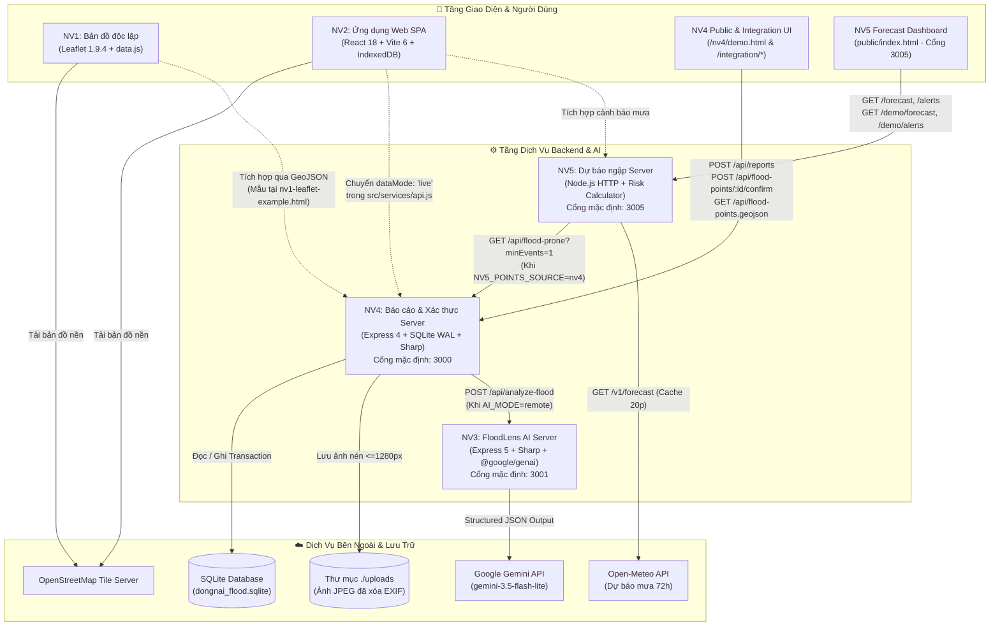
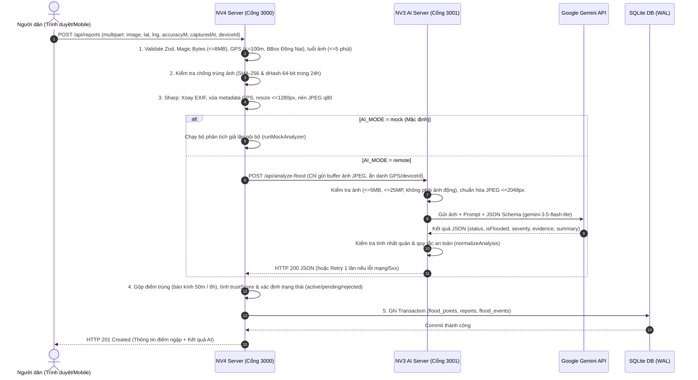

# 🌊 App Cảnh Báo Ngập Lụt Đồng Nai – Đấu Trường AI 2026

> **Chạy bản tích hợp (11/11/2026):** ở thư mục gốc chạy `npm install`, `npm run setup`, rồi `npm run dev` (hoặc `npm run dev:mock` khi chưa có key Gemini) và mở http://localhost:5173. Chi tiết, kịch bản demo và lỗi hay gặp: [docs/HUONG-DAN-CHAY.md](docs/HUONG-DAN-CHAY.md). Trong repo các phần nằm ở `frontend/` (NV2), `server/` (NV4), `backend/` (NV3), `nv5-forecast/` (NV5), `nv1-ban-do/` (NV1), `data/` (NV6).


> **Hệ thống hỗ trợ theo dõi điểm ngập, tiếp nhận phản ánh hiện trường từ người dân, phân tích hình ảnh ngập đường bằng AI (Google Gemini), xác thực cộng đồng và dự báo nguy cơ ngập theo lượng mưa tại tỉnh Đồng Nai.**

[](https://nodejs.org/)
[](https://react.dev/)
[](https://vite.dev/)
[](https://leafletjs.com/)
[-003B57?logo=sqlite&logoColor=white)](https://www.sqlite.org/)
[](https://ai.google.dev/)

---

## 📑 Mục lục

1. [Giới thiệu dự án và mục tiêu](#1-giới-thiệu-dự-án-và-mục-tiêu)
2. [Hiện trạng tích hợp & Phân biệt các module](#2-hiện-trạng-tích-hợp--phân-biệt-các-module)
3. [Tổng hợp chức năng các nhiệm vụ (NV1 – NV5)](#3-tổng-hợp-chức-năng-các-nhiệm-vụ-nv1--nv5)
4. [Công nghệ thực tế được sử dụng](#4-công-nghệ-thực-tế-được-sử-dụng)
5. [Sơ đồ kiến trúc hệ thống (Mermaid)](#5-sơ-đồ-kiến-trúc-hệ-thống-mermaid)
6. [Cấu trúc thư mục thực tế](#6-cấu-trúc-thư-mục-thực-tế)
7. [Hướng dẫn clone, cài đặt và chạy dự án](#7-hướng-dẫn-clone-cài-đặt-và-chạy-dự-án)
8. [Cấu hình môi trường (`.env`)](#8-cấu-hình-môi-trường-env)
9. [Danh sách API Endpoints thực tế](#9-danh-sách-api-endpoints-thực-tế)
10. [Hướng dẫn kiểm thử và chạy Demo](#10-hướng-dẫn-kiểm-thử-và-chạy-demo)
11. [Phân công nhiệm vụ (NV1 – NV6)](#11-phân-công-nhiệm-vụ-nv1--nv6)
12. [Hạn chế hiện tại và hướng phát triển](#12-hạn-chế-hiện-tại-và-hướng-phát-triển)

---

## 1. Giới thiệu dự án và mục tiêu

**App Cảnh Báo Ngập Lụt Đồng Nai** là dự án được phát triển trong khuôn khổ cuộc thi **Đấu trường AI 2026**, hướng tới giải quyết bài toán theo dõi và cảnh báo sớm tình trạng ngập úng đô thị tại tỉnh Đồng Nai (trọng tâm thử nghiệm tại khu vực TP. Biên Hòa và các huyện lân cận).

### 🎯 Mục tiêu cốt lõi
- **Với người dân:**
  - Quan sát trực quan các điểm đang ngập và các vị trí/tuyến đường hay ngập trên bản đồ số.
  - Gửi báo cáo hiện trường nhanh bằng hình ảnh kèm tọa độ GPS ngay trên điện thoại.
  - Tham gia xác nhận tình trạng thực tế tại điểm ngập (*"Vẫn còn ngập"* / *"Đã hết ngập"*).
  - Xem thông tin cảnh báo sớm và dự báo nguy cơ ngập theo lượng mưa (đặc biệt trong khung giờ buổi tối 19:00–23:00 cho ngày hôm sau).
- **Với cán bộ quản lý cấp phường/xã:**
  - Tiếp nhận, đối chiếu kết quả phân tích từ AI, xác minh thông tin, yêu cầu bổ sung hoặc đóng/ẩn báo cáo và theo dõi thống kê theo địa bàn phường.
- **Về mặt kỹ thuật & An toàn thông tin:**
  - Kết hợp phân tích ảnh bằng mô hình thị giác máy tính **Google Gemini** (`@google/genai`) với quy tắc kiểm chứng địa lý, chống trùng lặp ảnh (`SHA-256` & `dHash`), tính điểm tin cậy cộng đồng (`trustScore`) và tự động quản lý vòng đời điểm ngập.
  - Minh bạch hóa nguồn dữ liệu: phân biệt rõ ràng giữa dữ liệu **Mô phỏng / Demo** và dữ liệu thực tế, không tự ý suy diễn thông tin an toàn giao thông khi chưa được kiểm chứng thực địa.

---

## 2. Hiện trạng tích hợp & Phân biệt các module

> [!IMPORTANT]
> **Phân biệt giữa các module độc lập đã hoàn thiện và mức độ tích hợp toàn cục hiện tại:**
> Dự án được phát triển song song theo 5 phân hệ mã nguồn (`NV1` → `NV5`) trên các nhánh Git / thư mục worktree riêng biệt. Cần lưu ý rõ trạng thái kết nối thực tế trong code hiện tại để vận hành đúng cách:

| Phân hệ / Cặp kết nối | Trạng thái trong code thực tế | Chi tiết kỹ thuật |
| :--- | :---: | :--- |
| **NV4 ↔ NV3** *(Backend Báo cáo ↔ AI Gemini)* | ✅ **Đã tích hợp qua HTTP API** | `NV4` (`src/services/aiAnalyzer.js`) đã có sẵn client gọi trực tiếp `POST /api/analyze-flood` của `NV3` (cổng `3001`) khi đặt `AI_MODE=remote`, kèm cơ chế retry 1 lần và fail-safe chuyển `pending` khi lỗi. Mặc định `NV4` để `AI_MODE=mock` để chạy độc lập không tốn quota. |
| **NV5 ↔ NV4** *(Dự báo mưa ↔ Điểm hay ngập)* | ✅ **Đã tích hợp qua HTTP Adapter** | `NV5` (`src/adapters/floodPointsSource.js`) đã cài đặt sẵn adapter gọi trực tiếp `GET /api/flood-prone?minEvents=1` của `NV4` (cổng `3000`) khi đặt biến môi trường `NV5_POINTS_SOURCE=nv4`, có cache 10 phút và timeout 5 giây. |
| **NV4 ↔ Giao diện Demo / Tích hợp mẫu** | ✅ **Có sẵn trên Server NV4** | `NV4` phục vụ trực tiếp trang giao diện báo cáo & xác nhận tại `/nv4/demo.html`, bản đồ Leaflet tích hợp mẫu tại `/integration/nv1-leaflet-example.html` và module trang phường mẫu tại `/integration/nv2-wardpage-example.js`. |
| **NV1** *(Bản đồ Leaflet độc lập)* | 🟡 **Module độc lập (Dữ liệu tĩnh)** | Thư mục `nv1-test` là bản demo thuần HTML/CSS/JS hiển thị 6 điểm ngập giả lập từ `data.js`. Bản kết nối API GeoJSON động nằm ở file mẫu `nv4-test/integration/nv1-leaflet-example.html`. |
| **NV2** *(Ứng dụng SPA React Người dân & Quản lý)* | 🟡 **Chạy chế độ `demo` cục bộ** | Thư mục `nv2-test/frontend` là ứng dụng React 18 hoàn chỉnh giao diện và luồng nghiệp vụ, nhưng tầng dịch vụ `src/services/api.js` hiện đang đọc/ghi trên `IndexedDB` và `localStorage` (`dataMode: 'demo'`), chưa nối `fetch` trực tiếp sang REST API của `NV4` / `NV5`. |
| **Repository gốc (`main`)** | 🟡 **Chưa hợp nhất nhánh code** | Nhánh `main` tại `DauTruongAI_App-chong-ngap-lut` hiện chỉ lưu `README.md` tổng; code của 5 nhiệm vụ nằm trên 5 nhánh/worktree độc lập (`nv1-test` đến `nv5-test`). |

---

## 3. Tổng hợp chức năng các nhiệm vụ (NV1 – NV5)

### 🗺️ NV1 – Bản đồ số và hiển thị dữ liệu ngập (`nv1-test`)
- Khởi tạo bản đồ nền OpenStreetMap với thư viện **Leaflet 1.9.4** đặt tâm tại tỉnh Đồng Nai (`[11.35, 107.05]`, zoom `9`).
- Phân loại hiển thị marker bằng màu sắc trực quan:
  - **Đang ngập (`current`):** Đỏ (`#e23c41` – ngập nặng), Cam (`#ee8d28` – ngập vừa), Vàng (`#e5c42e` – ngập nhẹ).
  - **Vị trí hay ngập (`frequent`):** Xanh dương (`#2776cb`) có viền nét đứt (`dashArray`).
- Hỗ trợ bảng điều khiển bật/tắt độc lập 2 lớp bản đồ (`L.layerGroup`): *"Đang ngập (mẫu)"* và *"Hay ngập (mẫu)"*.
- Hiển thị Popup an toàn (chống XSS bằng hàm `escapeHtml`) cung cấp: tên vị trí, mức độ ngập, tổng số lần ngập (`floodCount`), tọa độ, mô tả, hình ảnh minh họa và nhãn cảnh báo dữ liệu mô phỏng.

### 💻 NV2 – Giao diện Người dân & Khu vực Quản lý (`nv2-test/frontend`)
- **Khu vực Người dân (`CitizenLayout`):**
  - **Bản đồ & Tra cứu (`/`, `/diem-ngap/:id`):** Xem điểm ngập công khai, lọc theo mức độ nghiêm trọng, khung thời gian (`6h`, `24h`, `7d`), khu vực và trạng thái xác minh; tìm kiếm địa điểm không dấu (`searchPlaces`).
  - **Gửi báo cáo hiện trường (`/bao-ngap`):** Chọn/chụp ảnh, tự động thu nhỏ cạnh dài về `1600px` bằng HTML5 Canvas (`downscalePhoto`), kiểm tra tọa độ trong vùng hỗ trợ, nhận kết quả phân tích AI (mô phỏng), lưu bản nháp tự động (`drafts.js`) và chống gửi trùng lặp bằng `requestId`.
  - **Xác nhận cộng đồng:** Gửi quan sát mới tại điểm ngập (*"Vẫn còn ngập"* kèm mức độ hoặc *"Nước đã rút"*).
  - **Cảnh báo & Dự báo (`/canh-bao`):** Xem danh sách cảnh báo theo khu vực và biểu đồ lượng mưa theo giờ.
  - **Tuyến đường bị ảnh hưởng (`/duong-bi-anh-huong`, `/tim-duong`):** Theo dõi danh sách tuyến đường ngập; màn hình tìm đường hiển thị trạng thái chờ tích hợp dịch vụ định tuyến (`routingEnabled: false`).
  - **Quản lý cá nhân (`/bao-cao-cua-toi`, `/bao-cao/:id`, `/tuy-chon`):** Theo dõi lịch sử xử lý báo cáo đã gửi, bổ sung thông tin/ảnh khi cán bộ yêu cầu (`addReportInfo`), chuyển đổi giao diện Sáng/Tối (Light/Dark theme) và bật/tắt **Công cụ trình diễn** (giả lập mất mạng, lỗi AI, timeout AI, lỗi tải tile bản đồ, khôi phục dữ liệu mẫu).
- **Khu vực Cán bộ Quản lý (`/quan-ly` - `AdminLayout`):**
  - Quản lý danh sách báo cáo có phân trang, tìm kiếm và bộ lọc đa chiều.
  - Thực hiện chuỗi hành động nghiệp vụ chặt chẽ (`allowedActions`): *Tiếp nhận (`receive`)*, *Yêu cầu bổ sung (`request-info`)*, *Xác nhận thông tin & công khai (`verify`)*, *Đánh dấu không hợp lệ (`invalid`)*, *Chuyển đang xử lý (`in-progress`)*, *Đóng báo cáo (`close`)*, *Ẩn khỏi bản đồ (`hide`)* và *Ghi chú phản hồi (`addAdminNote`)*.
  - Kiểm soát xung đột dữ liệu (Optimistic Concurrency Control) bằng trường `version` (`ConflictError`).
  - Xem bản đồ quản lý toàn địa bàn (`/quan-ly/ban-do`) và trạng thái các nguồn dữ liệu (`/quan-ly/nguon-du-lieu`).

### 🤖 NV3 – Dịch vụ AI phân tích ảnh ngập đường FloodLens (`nv3-test/backend`)
- Cung cấp dịch vụ REST API độc lập nhận ảnh hiện trường qua `POST /api/analyze-flood` (`multipart/form-data`, trường `image`).
- **Tiền xử lý & Bảo mật hình ảnh nghiêm ngặt (`src/utils.js`):**
  - Giới hạn dung lượng tối đa **5 MiB** (`5.242.880` byte), chỉ nhận đúng 1 file, không nhận field phụ.
  - Dùng `sharp` giải mã thực tế để kiểm tra định dạng (`JPEG`, `PNG`, `WebP`), từ chối ảnh giả mạo MIME, ảnh hỏng, ảnh động (`pages > 1`) hoặc ảnh vượt quá **25 triệu pixel**.
  - Tự động xoay ảnh theo hướng EXIF, thu nhỏ cạnh dài tối đa **2048px**, chuyển đổi sang JPEG chất lượng 85 và xóa toàn bộ metadata cá nhân trước khi gửi AI. Xử lý hoàn toàn trên RAM (`multer.memoryStorage()`).
- **Tích hợp Google Gemini (`src/gemini.js`):**
  - Sử dụng SDK `@google/genai` (mặc định model `gemini-3.5-flash-lite`) với cấu hình **Structured JSON Output** (`responseJsonSchema`) và `temperature: 0.1`.
  - Hỗ trợ chế độ `MOCK_GEMINI=true` phục vụ kiểm thử HTTP không cần khóa API.
- **Chuẩn hóa & Kiểm soát an toàn kết quả (`normalizeAnalysis`):**
  - Kiểm tra tính nhất quán giữa `status` (`flooded` / `not_flooded` / `uncertain`), `isFlooded` và `severity` (`none` / `low` / `medium` / `high` / `unknown`).
  - Tự động hạ kết quả về `uncertain` nếu thiếu bằng chứng (`evidence`) hoặc nếu nội dung trả về vi phạm quy tắc an toàn (chứa cam kết tuyến đường an toàn, suy đoán độ sâu cm/m chính xác...). Luôn gắn `needsVerification: true`.
- Cung cấp trang giao diện kiểm thử trực quan tại `GET /test`.

### 🛡️ NV4 – Backend Tiếp nhận Báo cáo, Xác thực Cộng đồng & Quản lý Điểm ngập (`nv4-test`)
- **Kiến trúc phân tầng (Layered Architecture):** Tách biệt rõ `routes` → `controllers` → `services` → `domain` (100% pure functions dễ kiểm thử) → `repositories` (SQLite WAL).
- **Quy trình tiếp nhận & Xác thực báo cáo (`POST /api/reports`):**
  1. Kiểm tra dữ liệu đầu vào bằng `Zod` và kiểm tra chữ ký nhị phân (**Magic Bytes**) của ảnh JPEG/PNG/WebP (tối đa 8 MB).
  2. Kiểm tra điều kiện địa lý & thời gian (`src/config/rules.js`): Tọa độ phải nằm trong Bounding Box tỉnh Đồng Nai (`Lat: 10.35–11.60`, `Lng: 106.75–107.60`), sai số GPS $\le 100\text{m}$, thời điểm chụp ảnh không cũ quá **5 phút** và không lệch tương lai quá 1 phút.
  3. Chống ảnh trùng lặp bằng mã băm **SHA-256** tuyệt đối và thuật toán băm cảm nhận thị giác **dHash 64-bit** (khoảng cách Hamming $\le 5$ trong vòng 24 giờ).
  4. Xử lý ảnh qua `sharp` (giới hạn 50M pixels chống decompression bomb, xóa sạch EXIF/GPS, thu nhỏ $\le 1280\text{px}$, nén JPEG `q80`).
  5. Gọi dịch vụ AI (`mock` hoặc `remote` sang NV3 cổng `3001`), ánh xạ qua `aiContract.js`.
  6. **Gộp điểm ngập trùng lặp (Deduplication):** Tự động gộp các báo cáo trong bán kính **50m** và cửa sổ **6 giờ** vào cùng một điểm ngập (`flood_points`), tính điểm tin cậy `trustScore` (thang 0–100) và mở/cập nhật sự kiện ngập (`flood_events`).
- **Xác nhận cộng đồng & Vòng đời tự động:**
  - Người dân trong bán kính $\le 300\text{m}$ có thể gửi xác nhận `still` hoặc `ended` (`POST /api/flood-points/:id/confirm`). Khi có đủ **2 thiết bị khác nhau** báo `ended`, điểm ngập tự động chuyển sang `resolved` và tăng bộ đếm lịch sử ngập (`floodEventCount`).
  - Tiến trình chạy nền (`expirationService.js`) quét mỗi 5 phút để tự động chuyển các điểm không có tương tác sau **6 giờ** sang trạng thái `expired`.
- **Cung cấp dữ liệu đa định dạng & Frontend nhúng:**
  - Xuất danh sách điểm ngập chuẩn **GeoJSON FeatureCollection** (`GET /api/flood-points.geojson`, hỗ trợ `ETag` & HTTP `304`), danh sách cụm đường hay ngập (`GET /api/flood-prone`) và thống kê theo phường/xã (`GET /api/wards/:wardId/flood-points`).
  - Cung cấp bộ thư viện giao diện Vanilla JS sẵn sàng nhúng (`public/nv4/`: `reportFlow.js`, `confirmWidget.js`, `camera.js`, `geo.js`).

### 🌧️ NV5 – Dự báo nguy cơ ngập theo lượng mưa & Cảnh báo sớm (`nv5-test/nv5-forecast`)
- Module độc lập hoàn toàn (zero external dependencies, sử dụng `node:http` thuần của Node.js $\ge 18$).
- **Thu thập dữ liệu mưa thực tế (`src/openMeteoClient.js`):**
  - Tích hợp API thời tiết **Open-Meteo** (`https://api.open-meteo.com/v1/forecast`) lấy dữ liệu lượng mưa (`precipitation`) và xác suất mưa (`precipitation_probability`) theo giờ trong 3 ngày theo múi giờ `Asia/Ho_Chi_Minh`, có bộ nhớ đệm (cache) 20 phút và timeout 8 giây.
  - Giữ nguyên giá trị `null` khi thiếu dữ liệu (không tự quy đổi `null` thành `0 mm` để tránh báo an toàn giả).
- **Mô hình tính toán nguy cơ (`src/riskCalculator.js`):**
  - Tính tổng lượng mưa trượt (rolling sum) trong các cửa sổ **1 giờ, 3 giờ và 6 giờ**.
  - Phân loại mức nguy cơ dựa trên lượng mưa tích lũy 3 giờ kết hợp lịch sử số lần ngập (`so_lan_ngap`):
    - **Thấp (`thap`):** $< 15\text{ mm}/3\text{h}$
    - **Trung bình (`trung_binh`):** $\ge 15\text{ mm}/3\text{h}$
    - **Cao (`cao`):** $\ge 30\text{ mm}/3\text{h}$
    - **Rất cao (`rat_cao`):** $\ge 50\text{ mm}/3\text{h}$ **và** điểm đã có lịch sử ngập $\ge 3$ lần.
  - Tự động gộp các khung giờ nguy cơ liên tiếp hoặc chồng lấn thành các khoảng cảnh báo (`mergeIntervals`).
- **Bộ lập lịch cảnh báo buổi tối (`src/alertScheduler.js`):**
  - Phát cảnh báo sớm cho **ngày mai** trong khung giờ buổi tối **19:00 – 23:00** (giờ Việt Nam), có cơ chế chống trùng lặp bản tin (`dedupStore`) và hỗ trợ cờ `simulate=19` để kiểm thử ngoài khung giờ.
- **Chế độ mô phỏng kịch bản mưa lớn (`src/demoScenarios.js`):**
  - Cung cấp 3 kịch bản mưa giả định (*Trung bình 20mm/3h*, *Cao 36mm/3h*, *Rất cao 60mm/3h + 3 lần ngập*) tách biệt hoàn toàn với dữ liệu Open-Meteo để phục vụ trình diễn.

---

## 4. Công nghệ thực tế được sử dụng

Dưới đây là danh mục công nghệ và thư viện thực tế được trích xuất trực tiếp từ các tệp `package.json` và mã nguồn của 5 phân hệ:

| Phân hệ | Ngôn ngữ & Kiểu Module | Framework / Thư viện chính | CSDL / Lưu trữ | Công cụ Kiểm thử & Build |
| :--- | :--- | :--- | :--- | :--- |
| **NV1** (`nv1-test`) | HTML5, CSS3, Vanilla JS | **Leaflet `1.9.4`** (qua CDN jsDelivr), OpenStreetMap Tiles | Mảng dữ liệu tĩnh trong `data.js` | Chạy trực tiếp trên trình duyệt |
| **NV2** (`nv2-test/frontend`) | JavaScript ES Modules (`JSX`) | **React `^18.3.1`**, **React DOM `^18.3.1`**, **React Router DOM `^6.28.0`**, **Leaflet `^1.9.4`**, CSS thuần + Font *Be Vietnam Pro* | **IndexedDB** & **localStorage** (`src/services/storage.js`) | **Vite `^6.0.1`**, `@vitejs/plugin-react` `^4.3.3` |
| **NV3** (`nv3-test/backend`) | Node.js $\ge 20.9.0$ (`ES Modules`) | **Express `5.3.0`**, **`@google/genai` `2.32.0`**, **Multer `2.5.0`**, **Sharp `0.35.5`**, **CORS `2.8.6`**, **Dotenv `18.0.10`** | Xử lý ảnh trên RAM (`MemoryStorage`), không lưu đĩa | `node --test` (Node built-in test runner) |
| **NV4** (`nv4-test`) | Node.js (`ES Modules`) | **Express `^4.21.2`**, **Zod `^3.24.2`**, **Multer `^1.4.5-lts.1`**, **Sharp `^0.33.5`**, **Express Rate Limit `^7.5.0`**, **CORS `^2.8.5`**, **Dotenv `^16.4.7`** | **SQLite 3** (`better-sqlite3` `^13.0.3`, chế độ `WAL`) + Lưu ảnh tại `./uploads` | **Vitest `^3.0.7`**, **Supertest `^7.0.0`** |
| **NV5** (`nv5-test/nv5-forecast`) | Node.js $\ge 18$ (`CommonJS`) | Thuần Node.js built-in (`node:http`, `node:fs/promises`, `globalThis.fetch`), kết nối **Open-Meteo API** | Bộ nhớ đệm trên RAM (`Map`) + File `data/flood-points.sample.json` | `node --test` (Node built-in test runner) |

---

## 5. Sơ đồ kiến trúc hệ thống (Mermaid)

### 5.1. Kiến trúc tổng thể và luồng tích hợp giữa các phân hệ

> *Ghi chú: Nét liền (`-->`) biểu thị luồng dữ liệu/API đã được lập trình và kết nối trong code; nét đứt (`-.->`) biểu thị luồng tích hợp theo thiết kế giữa các module đang chạy chế độ độc lập/demo.*



### 5.2. Luồng xử lý báo cáo ngập và phân tích AI (NV2/Client → NV4 → NV3)



---

## 6. Cấu trúc thư mục thực tế

Trong môi trường làm việc hiện tại (`D:\team_ai`), dự án bao gồm thư mục repository gốc và 5 thư mục worktree tương ứng với 5 nhánh nhiệm vụ:

```text
D:\team_ai\
├── DauTruongAI_App-chong-ngap-lut/          # Repository gốc (nhánh main)
│   └── README.md                            # Tài liệu tổng hợp toàn dự án (file hiện tại)
│
├── nv1-test/                                # [Nhánh: nv1-ban-do-va-hien-thi-du-lieu]
│   ├── assets/anh-minh-hoa.svg              # Hình minh họa hiển thị trong popup bản đồ
│   ├── data.js                              # 6 điểm ngập giả lập tại Đồng Nai
│   ├── index.html                           # Trang chính bản đồ Leaflet NV1
│   ├── main.js                              # Logic khởi tạo bản đồ, phân lớp và popup
│   ├── style.css                            # Định dạng giao diện bản đồ và chú giải
│   └── README.md                            # Tài liệu hướng dẫn NV1
│
├── nv2-test/                                # [Nhánh: nv2-frontend-ui]
│   ├── README.md                            # Tài liệu kiến trúc Frontend NV2
│   └── frontend/
│       ├── index.html                       # HTML entry point
│       ├── package.json                     # Khai báo React 18, Vite 6, React Router 6, Leaflet
│       └── src/
│           ├── main.jsx                     # Khởi tạo ứng dụng React
│           ├── app/                         # App.jsx (Routes), CitizenLayout.jsx, config.js
│           ├── components/ui/               # Component dùng chung (Button, Dialog, Badge, Feedback...)
│           ├── data/mock/                   # Dữ liệu mẫu (geo.js, photos.js, reports.js)
│           ├── features/                    # Các phân hệ màn hình:
│           │   ├── admin/                   # Quản lý báo cáo, bản đồ phường, nguồn dữ liệu
│           │   ├── alerts/                  # Cảnh báo và dự báo ngập
│           │   ├── auth/                    # Đăng nhập theo vai trò (nguoidan / quanly)
│           │   ├── map/                     # Bản đồ tương tác, bộ lọc, tìm kiếm
│           │   ├── report/                  # Luồng gửi báo cáo (ReportFlow), báo cáo của tôi
│           │   ├── roads/                   # Tuyến đường bị ảnh hưởng & Tìm đường
│           │   └── settings/                # Tùy chọn giao diện & Công cụ trình diễn
│           ├── hooks/                       # Custom hooks (theme, online status...)
│           ├── locales/vi/                  # Từ điển nhãn giao diện tiếng Việt
│           ├── services/                    # api.js (Facade), storage.js (IndexedDB), drafts.js
│           ├── styles/                      # Hệ thống CSS tokens và styles
│           └── utils/                       # Hàm tiện ích thời gian và định dạng
│
├── nv3-test/                                # [Nhánh: feat/nv3-ai-backend]
│   └── backend/
│       ├── .env.example                     # Mẫu cấu hình biến môi trường NV3
│       ├── package.json                     # Express 5, @google/genai, Multer, Sharp
│       ├── README-NV3.md                    # Tài liệu đặc tả API & báo cáo kiểm thử Gemini
│       ├── public/test.html                 # Giao diện web kiểm thử upload ảnh phân tích AI
│       ├── scripts/                         # check.js (kiểm tra cú pháp), start-mock.js, live-smoke.js
│       ├── src/
│       │   ├── server.js                    # Điểm khởi chạy HTTP Server NV3 (Cổng 3001)
│       │   ├── app.js                       # Cấu hình Express, CORS, Multer, Routes
│       │   ├── config.js                    # Đọc và kiểm tra biến môi trường
│       │   ├── gemini.js                    # Prompt, JSON Schema và gọi SDK Google Gemini
│       │   └── utils.js                     # Xử lý ảnh bằng Sharp và chuẩn hóa kết quả AI
│       └── tests/                           # 24 unit & HTTP tests (gemini, http, utils)
│
├── nv4-test/                                # [Nhánh: nv4-bao-cao-va-xac-thuc]
│   ├── .env.example                         # Mẫu cấu hình biến môi trường NV4
│   ├── package.json                         # Express 4, better-sqlite3, Sharp, Zod, Vitest
│   ├── requests.http                        # Kịch bản gọi thử API cho REST Client
│   ├── data/
│   │   ├── demo/                            # seed-flood-points.json (20 điểm), wards.demo.json
│   │   └── real/                            # Thư mục chờ nạp dữ liệu GIS thực tế từ NV6
│   ├── docs/                                # Bộ tài liệu kỹ thuật: API.md, INTEGRATION.md, NV4_HANDOFF.md...
│   ├── integration/                         # Mã mẫu tích hợp cho NV1 (Leaflet), NV2 (Ward), NV5 (Adapter)
│   ├── public/nv4/                          # Module JS phía client: demo.html, reportFlow.js, confirmWidget.js...
│   ├── scripts/                             # migrate.js, seed.js, seedClear.js, demo-reset.js, e2e.js, verify.js
│   ├── src/
│   │   ├── server.js                        # Khởi chạy Express Server NV4 (Cổng 3000) & Cron job hết hạn
│   │   ├── config/                          # env.js, rules.js (hằng số nghiệp vụ)
│   │   ├── controllers/                     # reportController, floodPointController, confirmationController
│   │   ├── db/connection.js                 # Kết nối SQLite chế độ WAL
│   │   ├── domain/                          # Logic thuần: geo, dedupe, lifecycle, trustScore, imageHash, aiContract
│   │   ├── middleware/rateLimiter.js        # Giới hạn tần suất theo IP và deviceId
│   │   ├── repositories/                    # Truy xuất CSDL (floodPointRepo, reportRepo, eventRepo, confirmationRepo)
│   │   ├── routes/                          # reportRoutes, floodPointRoutes, wardRoutes
│   │   ├── services/                        # reportService, aiAnalyzer, confirmationService, expirationService...
│   │   └── utils/imageUtils.js              # Kiểm tra magic bytes, nén Sharp, tính SHA-256 & dHash
│   ├── tests/                               # 20 file kiểm thử tự động (198 test cases)
│   └── uploads/                             # Lưu trữ ảnh báo cáo đã nén và xóa EXIF
│
└── nv5-test/                                # [Nhánh: nv5-du-bao-ngap]
    └── nv5-forecast/
        ├── package.json                     # Cấu hình scripts start, demo, test
        ├── README.md                        # Hướng dẫn vận hành NV5 và tích hợp NV4
        ├── api/routes.js                    # Định tuyến HTTP (/forecast, /alerts, /demo/*)
        ├── data/flood-points.sample.json    # Dữ liệu điểm ngập mẫu khi chạy độc lập
        ├── public/                          # Giao diện web xem dự báo & mô phỏng mưa (index.html, app.js, style.css)
        ├── src/
        │   ├── server.js                    # HTTP Server NV5 (Cổng 3005)
        │   ├── config.js                    # Ngưỡng mưa (15/30/50mm), khung giờ 19h-23h, cấu hình Open-Meteo & NV4
        │   ├── openMeteoClient.js           # Client gọi API Open-Meteo có cache & timeout
        │   ├── riskCalculator.js            # Tính mưa tích lũy 1h/3h/6h, phân loại nguy cơ & gộp khoảng giờ
        │   ├── alertScheduler.js            # Kiểm tra khung giờ tối 19:00-23:00 & chống trùng cảnh báo
        │   ├── alertFormatter.js            # Định dạng thông điệp cảnh báo tiếng Việt
        │   ├── demoScenarios.js             # 3 kịch bản mưa mô phỏng (trung_binh, cao, rat_cao)
        │   ├── time.js                      # Xử lý múi giờ Việt Nam (UTC+7)
        │   └── adapters/floodPointsSource.js# Adapter đọc điểm ngập từ JSON hoặc API NV4
        └── tests/                           # Bộ kiểm thử nv5.test.js, nv4Adapter.test.js, demo.test.js
```

---

## 7. Hướng dẫn clone, cài đặt và chạy dự án

### Yêu cầu hệ thống
- **Node.js:** Khuyến nghị **Node.js `>= 20.9.0`** (để tương thích đồng thời với `NV3` yêu cầu `>= 20.9.0`, `NV2` và `NV5` yêu cầu `>= 18`).
- **Trình quản lý gói:** `npm` (đi kèm Node.js).
- **Trình duyệt web hiện đại:** Chrome, Edge hoặc Firefox (cần kết nối Internet để tải thư viện Leaflet CDN ở NV1, bản đồ nền OpenStreetMap, dữ liệu mưa Open-Meteo ở NV5 và gọi Gemini API ở NV3).

### 7.1. Cách lấy mã nguồn từ GitHub

Repository trên GitHub quản lý các nhiệm vụ trên các nhánh riêng biệt:
- `nv1-ban-do-va-hien-thi-du-lieu`
- `nv2-frontend-ui`
- `feat/nv3-ai-backend`
- `nv4-bao-cao-va-xac-thuc`
- `nv5-du-bao-ngap`

Nếu clone mới từ GitHub, bạn có thể tải repository và tạo các thư mục worktree (giống hệt cấu trúc `D:\team_ai` hiện tại):

```powershell
git clone https://github.com/trucnhttruc2112-ship-it/DauTruongAI_App-chong-ngap-lut.git
cd DauTruongAI_App-chong-ngap-lut

# Tạo các thư mục tương ứng từng phân hệ (nếu chưa có sẵn trên máy)
git worktree add ../nv1-test origin/nv1-ban-do-va-hien-thi-du-lieu
git worktree add ../nv2-test origin/nv2-frontend-ui
git worktree add ../nv3-test origin/feat/nv3-ai-backend
git worktree add ../nv4-test origin/nv4-bao-cao-va-xac-thuc
git worktree add ../nv5-test origin/nv5-du-bao-ngap
```

---

### 7.2. Cài đặt và chạy từng phân hệ độc lập

#### 🔹 1. Chạy NV1 (Bản đồ Leaflet tĩnh)
Không cần cài đặt thư viện Node.js.
- Mở trực tiếp tệp `D:\team_ai\nv1-test\index.html` bằng trình duyệt Chrome/Edge, hoặc sử dụng tiện ích **Live Server** trong VS Code.

#### 🔹 2. Chạy NV2 (Ứng dụng Frontend React)
```powershell
cd D:\team_ai\nv2-test\frontend
npm install
npm run dev
```
- Mở địa chỉ hiển thị trên terminal (mặc định của Vite là `http://localhost:5173`).
- Các lệnh khác trong `package.json`:
  - `npm run build`: Đóng gói bản production vào thư mục `dist/`.
  - `npm run preview`: Xem thử bản build production.

#### 🔹 3. Chạy NV3 (Dịch vụ AI phân tích ảnh ngập – Cổng `3001`)
```powershell
cd D:\team_ai\nv3-test\backend
npm ci
Copy-Item .env.example .env
```
- **Chạy với chế độ Mock (không cần Gemini API Key):**
  ```powershell
  npm run start:mock
  ```
- **Chạy với Google Gemini thật:** Điền `GEMINI_API_KEY` vào tệp `backend/.env`, sau đó chạy:
  ```powershell
  npm start
  # Hoặc chạy chế độ tự động tải lại khi sửa code:
  npm run dev
  ```
- Truy cập trang kiểm thử trực quan: `http://localhost:3001/test`
- Kiểm tra trạng thái dịch vụ: `http://localhost:3001/api/health`

#### 🔹 4. Chạy NV4 (Backend Báo cáo ngập & Xác thực – Cổng `3000`)
```powershell
cd D:\team_ai\nv4-test
npm install
Copy-Item .env.example .env

# Khởi tạo bảng cơ sở dữ liệu SQLite
npm run migrate

# Nạp 20 điểm ngập mẫu tại Đồng Nai
npm run seed

# Khởi chạy server phát triển (hoặc dùng npm start)
npm run dev
```
- Máy chủ chạy tại: `http://localhost:3000`
- Giao diện Demo gửi báo cáo & xác nhận của NV4: `http://localhost:3000/nv4/demo.html`
- Bản đồ Leaflet tích hợp API GeoJSON mẫu: `http://localhost:3000/integration/nv1-leaflet-example.html`

#### 🔹 5. Chạy NV5 (Mô hình Dự báo ngập theo lượng mưa – Cổng `3005`)
```powershell
cd D:\team_ai\nv5-test\nv5-forecast

# Chạy độc lập với tệp dữ liệu mẫu data/flood-points.sample.json
npm start

# Hoặc chạy kèm cờ bật chế độ mô phỏng kịch bản mưa lớn
npm run demo
```
- Mở trình duyệt tại: `http://localhost:3005`

---

### 7.3. Hướng dẫn chạy kết nối liên thông (NV3 + NV4 + NV5)

Để chạy chuỗi tích hợp thực tế đã được lập trình giữa **NV3 (AI)**, **NV4 (Backend chính)** và **NV5 (Dự báo mưa)**, mở 3 cửa sổ PowerShell:

1. **Terminal 1 – Khởi động AI Server NV3 (Cổng `3001`):**
   ```powershell
   cd D:\team_ai\nv3-test\backend
   # Dùng npm start (nếu đã cấu hình GEMINI_API_KEY trong .env) hoặc dùng mock:
   npm run start:mock
   ```
2. **Terminal 2 – Khởi động Backend NV4 kết nối sang NV3 (Cổng `3000`):**
   Trong tệp `D:\team_ai\nv4-test\.env`, đặt `AI_MODE=remote` và `AI_ANALYZE_URL=http://localhost:3001/api/analyze-flood`, sau đó chạy:
   ```powershell
   cd D:\team_ai\nv4-test
   npm run migrate
   npm run demo:reset
   npm start
   ```
3. **Terminal 3 – Khởi động Dự báo NV5 lấy điểm ngập từ API NV4 (Cổng `3005`):**
   ```powershell
   cd D:\team_ai\nv5-test\nv5-forecast
   $env:NV5_POINTS_SOURCE="nv4"
   $env:NV4_API_URL="http://localhost:3000"
   npm start
   ```

---

## 8. Cấu hình môi trường (`.env`)

> [!CAUTION]
> Tuyệt đối không commit tệp `.env` hoặc khóa `GEMINI_API_KEY` lên Git. Chỉ sao chép từ tệp `.env.example` trên máy cục bộ.

### 8.1. Biến môi trường của NV3 (`D:\team_ai\nv3-test\backend\.env`)

| Tên biến | Mặc định trong code | Mẫu `.env.example` | Mô tả chi tiết |
| :--- | :--- | :--- | :--- |
| `GEMINI_API_KEY` | `""` (rỗng) | *(để trống)* | Khóa API lấy từ Google AI Studio. Bắt buộc khi `MOCK_GEMINI=false`. |
| `GEMINI_MODEL` | `gemini-3.5-flash-lite` | `gemini-3.5-flash-lite` | Tên model Gemini hỗ trợ xử lý ảnh và Structured JSON Output. |
| `PORT` | `3001` | `3001` | Cổng lắng nghe HTTP của dịch vụ NV3 (`1` – `65535`). |
| `ALLOWED_ORIGINS` | `http://localhost:5173,http://localhost:3000` | `http://localhost:5173,http://localhost:3000` | Danh sách các HTTP(S) Origin được phép gọi CORS, phân tách bằng dấu phẩy. |
| `MOCK_GEMINI` | `false` | `false` | Đặt `true` để trả kết quả giả lập (`status: "uncertain"`, `mode: "mock"`) mà không gọi Google. |
| `GEMINI_TIMEOUT_MS` | `30000` | `60000` | Thời gian chờ tối đa cho 1 yêu cầu gọi Gemini (`1` – `120000` ms). |

### 8.2. Biến môi trường của NV4 (`D:\team_ai\nv4-test\.env`)

| Tên biến | Mặc định trong code | Mô tả chi tiết |
| :--- | :--- | :--- |
| `NODE_ENV` | `development` | Môi trường chạy (`development`, `test`, `production`). |
| `PORT` | `3000` | Cổng HTTP của máy chủ NV4. |
| `DB_PATH` | `./data/dongnai_flood.sqlite` | Đường dẫn tệp cơ sở dữ liệu SQLite (tự động dùng `:memory:` khi `NODE_ENV=test`). |
| `UPLOAD_DIR` | `./uploads` | Thư mục lưu trữ ảnh báo cáo sau khi nén. |
| `DATA_MODE` | `demo` | Chế độ dữ liệu: `demo` (cho phép dữ liệu mẫu) hoặc `real` (cấm dữ liệu mẫu và cấm `AI_MODE=mock`). |
| `AI_MODE` | `mock` | Chế độ phân tích ảnh: `mock` (giả lập nội bộ) hoặc `remote` (gọi sang server NV3). |
| `AI_ANALYZE_URL` | `http://localhost:3001/api/analyze-flood` | Endpoint nhận ảnh phân tích của NV3 khi `AI_MODE=remote`. |
| `AI_API_KEY` | `""` | Khóa gửi kèm trong header `X-API-Key` sang NV3 (nếu có). |
| `AI_TIMEOUT_MS` | `20000` | Thời gian chờ phản hồi từ NV3 (ms) trước khi hủy request. |
| `PUBLIC_BASE_URL` | `http://localhost:3000` | URL gốc dùng để ghép đường dẫn ảnh tuyệt đối trả về cho client. |
| `ALLOWED_ORIGINS` | `http://localhost:3000,http://127.0.0.1:3000` | Danh sách Origin được phép qua CORS (bắt buộc khai báo khi `NODE_ENV=production`). |
| `TRUST_PROXY` | `loopback` (dev) / `false` (prod) | Cấu hình `trust proxy` cho Express (`true`, `false`, số hop, `loopback` hoặc dải IP/CIDR). |
| `ALLOW_DEMO_IN_PROD` | `false` | Cờ cho phép chạy `DATA_MODE=demo` hoặc `AI_MODE=mock` khi `NODE_ENV=production` (chỉ bật khi thử nghiệm có chủ đích). |

### 8.3. Biến môi trường của NV5 (`D:\team_ai\nv5-test\nv5-forecast`)

`NV5` đọc trực tiếp từ biến môi trường của tiến trình (`process.env`) mà không cần thư viện `dotenv`:

| Tên biến | Mặc định | Mô tả chi tiết |
| :--- | :--- | :--- |
| `PORT` | `3005` | Cổng HTTP của máy chủ dự báo NV5. |
| `NV5_POINTS_SOURCE` | `json` | Nguồn lấy danh sách điểm ngập: `json` (đọc `data/flood-points.sample.json`) hoặc `nv4` (gọi API của NV4). |
| `NV4_API_URL` | `http://localhost:3000` | Địa chỉ máy chủ NV4 khi `NV5_POINTS_SOURCE=nv4`. |
| `NV4_FALLBACK_JSON` | *(tắt)* | Đặt bằng `"1"` nếu muốn tự động chuyển về đọc JSON mẫu khi mất kết nối tới NV4. |
| `NV5_DEMO` | *(tự động ở localhost)* | Đặt bằng `"1"` để bật các endpoint mô phỏng kịch bản mưa (`/demo/*`) ngoài `NODE_ENV=production`. |

---

## 9. Danh sách API Endpoints thực tế

### 9.1. Dịch vụ AI phân tích ảnh – NV3 (Mặc định cổng `3001`)

| Phương thức | Đường dẫn | Đầu vào / Tham số | Mô tả & Phản hồi thực tế |
| :---: | :--- | :--- | :--- |
| `GET` | `/api/health` | Không | Kiểm tra trạng thái cấu hình dịch vụ (`status: "ok"`, `service: "floodlens-nv3"`, `mode`, `gemini.configured`, `analysisReady`). Không gọi Google API. |
| `POST` | `/api/analyze-flood` | `multipart/form-data` với duy nhất 1 trường file `image` (JPEG/PNG/WebP tĩnh, $\le 5\text{ MiB}$, $\le 25\text{ MP}$) | Phân tích ảnh ngập đường qua Gemini hoặc Mock. Trả về HTTP `200` với 9 trường: `isFlooded` (`boolean\|null`), `status` (`flooded\|not_flooded\|uncertain`), `severity` (`none\|low\|medium\|high\|unknown`), `evidence` (`string[]`), `summary` (`string`), `needsVerification` (`true`), `analyzedAt`, `model`, `mode`. |
| `GET` | `/test` | Không | Trang giao diện HTML độc lập để chọn ảnh, xem trước và kiểm thử trực tiếp API `/api/analyze-flood`. |

### 9.2. Dịch vụ Báo cáo ngập & Xác thực – NV4 (Mặc định cổng `3000`)

Mọi phản hồi JSON từ NV4 (trừ endpoint `.geojson`) đều được bọc theo chuẩn `{ "ok": true, "data": ... }` hoặc `{ "ok": false, "error": { "code", "message" } }`.

| Phương thức | Đường dẫn | Tham số Query / Body chính | Mô tả & Quy tắc nghiệp vụ |
| :---: | :--- | :--- | :--- |
| `GET` | `/api/health` | Không | Trả về trạng thái máy chủ (`status: "up"`), thời gian, tổng số điểm ngập (`pointsCount`), `aiMode` và `dataMode`. |
| `POST` | `/api/reports` | `multipart/form-data`: `image` (bắt buộc, $\le 8\text{MB}$), `lat`, `lng`, `accuracyM` ($\le 100$), `capturedAt` ($\le 5$ phút), `deviceId` (UUID), `source` (`camera\|gallery\|manual-pin`), `note` ($\le 200$ ký tự) | Tiếp nhận báo cáo ngập từ người dân. Giới hạn **5 báo cáo/giờ/deviceId** và **20 requests/phút/IP**. Kiểm tra tọa độ Đồng Nai, chống trùng ảnh, nén ảnh xóa EXIF, gọi AI và tự động gộp điểm trong bán kính 50m / 6h. |
| `GET` | `/api/flood-points` | Query tùy chọn: `status` (mặc định `active`), `wardId`, `severity` (`low\|medium\|high`), `isFloodProne` (`true\|false`), `limit` ($\le 1000$), `bbox` (`minLng,minLat,maxLng,maxLat`) | Lấy danh sách điểm ngập dạng mảng đối tượng JSON phẳng, sắp xếp theo thời gian cập nhật mới nhất. |
| `GET` | `/api/flood-points.geojson` | Query giống `/api/flood-points` | Xuất dữ liệu chuẩn **GeoJSON `FeatureCollection`** (tọa độ `[lng, lat]`) phục vụ vẽ trực tiếp lên Leaflet. Hỗ trợ `Cache-Control: public, max-age=10` và `ETag` (`304 Not Modified`). |
| `GET` | `/api/flood-points/:id` | URL Param: `:id` | Xem chi tiết một điểm ngập kèm danh sách đường dẫn ảnh (`images`), mô tả AI (`aiDescription`) và lịch sử các đợt ngập (`events`). |
| `POST` | `/api/flood-points/:id/confirm` | JSON Body: `type` (`still\|ended`), `deviceId`, `lat`, `lng` | Người dân trong bán kính $\le 300\text{m}$ xác nhận tình trạng ngập. Giới hạn 10 req/phút/IP. Đủ 2 thiết bị báo `ended` sẽ chuyển điểm sang `resolved`. |
| `GET` | `/api/flood-prone` | Query: `minEvents` (mặc định `3`), `wardId` | Danh sách các cụm tuyến đường/vị trí hay ngập kèm tọa độ tâm (`centerLat`, `centerLng`), tổng số đợt ngập (`eventCount`) và mức độ trung bình (`avgSeverity`). |
| `GET` | `/api/wards/:wardId/flood-points` | URL Param: `:wardId` (VD: `long-binh`) | Thống kê tổng quan (`activeCount`, `proneCount`, `totalEvents`) và danh sách điểm ngập gom nhóm theo từng tuyến đường trong phường. |

### 9.3. Dịch vụ Dự báo ngập theo lượng mưa – NV5 (Mặc định cổng `3005`)

| Phương thức | Đường dẫn | Tham số Query | Mô tả & Phản hồi thực tế |
| :---: | :--- | :--- | :--- |
| `GET` | `/forecast` | Tùy chọn: `lat`, `lng`, `so_lan` (thêm 1 điểm thử nghiệm vào danh sách) | Lấy dữ liệu mưa theo giờ từ Open-Meteo, tính lượng mưa tích lũy `1h`/`3h`/`6h`, phân loại nguy cơ (`thap`, `trung_binh`, `cao`, `rat_cao`, `khong_du_du_lieu`) và gộp các khoảng giờ cảnh báo cho từng điểm ngập. |
| `GET` | `/alerts` | Tùy chọn: `lat`, `lng`, `so_lan`, `simulate=19` | Kiểm tra và sinh bản tin cảnh báo sớm cho **ngày mai** nếu thời điểm hiện tại nằm trong khung giờ **19:00 – 23:00** (giờ VN) hoặc khi truyền `simulate=19`. Có lọc chống trùng bản tin (`newAlerts`). |
| `GET` | `/demo/info` | Không | Trả về trạng thái cho phép chạy demo (`demoAllowed`) và danh sách 3 kịch bản mưa mẫu (`trung_binh`, `cao`, `rat_cao`). |
| `GET` | `/demo/forecast` | Bắt buộc: `scenario` (`trung_binh\|cao\|rat_cao`), `lat`, `lng` | Tính toán dự báo nguy cơ ngập trên lượng mưa mô phỏng (không gọi Open-Meteo). Bị vô hiệu hóa (`403 DEMO_DISABLED`) khi `NODE_ENV=production`. |
| `GET` | `/demo/alerts` | Bắt buộc: `scenario`, `lat`, `lng`; tùy chọn: `simulate=19` | Mô phỏng phát cảnh báo buổi tối với kịch bản mưa lớn giả định, tự động gắn nhãn `[DEMO - dữ liệu mô phỏng]` vào thông điệp. |

---

## 10. Hướng dẫn kiểm thử và chạy Demo

### 10.1. Chạy bộ kiểm thử tự động (Automated Tests)

Các phân hệ backend (`NV3`, `NV4`, `NV5`) đều được trang bị bộ kiểm thử tự động độc lập, không làm ảnh hưởng đến cơ sở dữ liệu phát triển hay tiêu tốn quota API bên ngoài:

- **Kiểm thử NV3 (24/24 tests):**
  ```powershell
  cd D:\team_ai\nv3-test\backend
  npm run check    # Kiểm tra cú pháp toàn bộ mã nguồn, scripts và JS trong test.html
  npm test         # Chạy 24 unit & HTTP tests (config, sharp, chuẩn hóa JSON, CORS, mã lỗi)
  ```
  *(Tùy chọn)* Khi đã cấu hình `GEMINI_API_KEY` thật và `MOCK_GEMINI=false`, có thể kiểm thử gọi Gemini thật với 1 ảnh thực tế:
  ```powershell
  npm run test:live -- "duong_dan_anh_thuc_te.jpg"
  ```

- **Kiểm thử NV4 (198/198 tests + E2E + Benchmark + Verify):**
  ```powershell
  cd D:\team_ai\nv4-test
  npm test         # Chạy 20 bộ test với Vitest (Domain, API, Bảo mật, Rate limit, AI Adapter...)
  npm run e2e      # Chạy kịch bản End-to-End 6 bước nghiệp vụ trên SQLite :memory:
  npm run bench    # Đo hiệu năng truy vấn GeoJSON và Flood-prone với 1.000 điểm trên DB tạm
  npm run verify   # Kiểm tra tổng thể 6 hạng mục bàn giao và xuất báo cáo docs/VERIFY_REPORT.md
  ```

- **Kiểm thử NV5:**
  ```powershell
  cd D:\team_ai\nv5-test\nv5-forecast
  npm test         # Chạy toàn bộ test trong thư mục tests/ (nv5, nv4Adapter, demo)
  ```

---

### 10.2. Kịch bản chạy Demo trực quan cho buổi thuyết trình

1. **Trình diễn Giao diện Người dân & Quản lý (NV2):**
   - Khởi chạy `npm run dev` tại `D:\team_ai\nv2-test\frontend` và mở trình duyệt.
   - Tại trang **Đăng nhập (`/dang-nhap`)**, sử dụng 2 tài khoản thử nghiệm được khai báo sẵn trong `src/services/api.js` (với mật khẩu bất kỳ từ **6 ký tự trở lên**, ví dụ `123456`):
     - Tài khoản Người dân: `nguoidan`
     - Tài khoản Cán bộ quản lý: `quanly`
   - Trải nghiệm gửi báo cáo tại `/bao-ngap`, xác nhận tình trạng tại điểm ngập, sau đó đăng nhập bằng `quanly` vào `/quan-ly` để duyệt công khai báo cáo lên bản đồ hoặc yêu cầu người dân bổ sung thông tin.
   - Vào mục **Tùy chọn (`/tuy-chon`)** để bật thử các **Công cụ trình diễn** (giả lập rớt mạng, AI quá thời gian chờ, khôi phục dữ liệu mẫu ban đầu).

2. **Trình diễn Luồng Báo cáo thực tế, Chống trùng & Bản đồ GeoJSON (NV4 + NV3):**
   - Chạy lệnh `npm run demo:reset` tại `D:\team_ai\nv4-test` để nạp 12 điểm ngập chuẩn với mốc thời gian tương đối vừa xảy ra (10–90 phút trước), rồi chạy `npm start`.
   - Mở `http://localhost:3000/nv4/demo.html` để thực hiện gửi báo cáo ngập thật qua API và bấm nút xác nhận *"Vẫn ngập"* / *"Đã hết ngập"*.
   - Mở `http://localhost:3000/integration/nv1-leaflet-example.html` để xem bản đồ Leaflet tải trực tiếp từ endpoint `/api/flood-points.geojson` (tách 2 lớp *Đang ngập* và *Hay ngập* có viền tím).

3. **Trình diễn Dự báo mưa & Cảnh báo buổi tối 19:00 (NV5):**
   - Chạy `npm run demo` tại `D:\team_ai\nv5-test\nv5-forecast` và mở `http://localhost:3005`.
   - Chọn kịch bản mưa **Cao (36mm/3h)** hoặc **Rất cao (60mm/3h + 3 lần ngập)** và nhấn nút **"Mô phỏng cảnh báo 19:00"** để xem hệ thống tổng hợp khoảng giờ nguy cơ ngập ngày mai và phát bản tin cảnh báo sớm.

---

## 11. Phân công nhiệm vụ (NV1 – NV6)

| Mã NV | Tên phân hệ / Nhiệm vụ | Thư mục / Nhánh tương ứng | Trạng thái thực tế |
| :---: | :--- | :--- | :--- |
| **NV1** | Bản đồ số và hiển thị dữ liệu ngập Đồng Nai bằng Leaflet | `D:\team_ai\nv1-test`<br>*(Nhánh: `nv1-ban-do-va-hien-thi-du-lieu`)* | ✅ Đã hoàn thành bản demo độc lập (6 điểm mẫu, 2 lớp bật/tắt, popup an toàn). Đã có thêm bản tích hợp GeoJSON mẫu tại `nv4-test/integration/nv1-leaflet-example.html`. |
| **NV2** | Giao diện ứng dụng Web (Người dân & Cán bộ quản lý cấp phường) | `D:\team_ai\nv2-test\frontend`<br>*(Nhánh: `nv2-frontend-ui`)* | ✅ Đã hoàn thành toàn bộ màn hình React 18, luồng báo cáo, quản lý duyệt tin, giao diện sáng/tối và công cụ trình diễn (đang chạy ở chế độ dữ liệu cục bộ `dataMode: 'demo'`). |
| **NV3** | Dịch vụ AI phân tích ảnh ngập đường (FloodLens Backend) | `D:\team_ai\nv3-test\backend`<br>*(Nhánh: `feat/nv3-ai-backend`)* | ✅ Đã hoàn thành API Express 5 + Sharp + Google Gemini (`gemini-3.5-flash-lite`), trang `/test`, chế độ mock và vượt qua 24/24 unit/HTTP tests cùng đợt kiểm thử ảnh thật. |
| **NV4** | Backend Tiếp nhận báo cáo, Xác thực cộng đồng, Quản lý vòng đời & CSDL | `D:\team_ai\nv4-test`<br>*(Nhánh: `nv4-bao-cao-va-xac-thuc`)* | ✅ Đã hoàn thành toàn diện 9 endpoints API, SQLite WAL, xử lý ảnh Sharp, chống trùng SHA-256/dHash, kết nối AI NV3, gói tích hợp liên module và vượt qua 198/198 tests. |
| **NV5** | Mô hình Dự báo nguy cơ ngập theo lượng mưa (Open-Meteo) & Cảnh báo tối | `D:\team_ai\nv5-test\nv5-forecast`<br>*(Nhánh: `nv5-du-bao-ngap`)* | ✅ Đã hoàn thành server dự báo mưa 1h/3h/6h, bộ lập lịch cảnh báo 19:00–23:00, kịch bản mô phỏng mưa lớn và adapter kết nối trực tiếp API `/api/flood-prone` của NV4. |
| **NV6** | Thu thập dữ liệu nền thực địa, Ranh giới hành chính GIS, Kiểm thử Mobile & Tổng hợp | `data/real/` (trong NV4) & `README.md` tổng | 🟡 Đã có bộ 57 kịch bản kiểm thử (`nv4-test/docs/TEST_CASES.csv`) và 15 tình huống kiểm thử di động (`MOBILE_TEST.md`). Thư mục `nv4-test/data/real/` hiện mới có `.gitkeep`, đang chờ bàn giao dữ liệu GIS ranh giới phường/xã chính thức. |

---

## 12. Hạn chế hiện tại và hướng phát triển

### ⚠️ Những hạn chế hiện tại (dựa trên mã nguồn thực tế)
1. **Chưa hợp nhất thành một ứng dụng Monorepo / Full-stack duy nhất trên nhánh `main`:**
   - Giao diện React của **NV2** (`nv2-test/frontend`) hiện vẫn chạy độc lập với dữ liệu giả lập trên trình duyệt (`IndexedDB` / `localStorage`, `dataMode: 'demo'`), chưa thay thế các hàm trong `src/services/api.js` để gọi trực tiếp sang REST API của **NV4** (cổng `3000`) và **NV5** (cổng `3005`).
   - Bản đồ **NV1** (`nv1-test`) vẫn đọc mảng tĩnh từ `data.js`.
2. **Dữ liệu địa lý & Ranh giới hành chính đang ở mức ước lượng:**
   - **NV4** hiện kiểm tra phạm vi tỉnh Đồng Nai bằng hình chữ nhật bao quanh (*Bounding Box*: `Lat 10.35–11.60`, `Lng 106.75–107.60`) và gán mã phường/xã (`wardId`) dựa trên từ khóa tên đường hoặc khoảng cách tới tâm phường giả lập (`wards.demo.json`), nên các điểm ngập đang mang cờ `WARD_ESTIMATED`.
   - Thư mục dữ liệu thực tế `nv4-test/data/real/` chưa có dữ liệu Polygon GeoJSON chính thức từ **NV6**.
3. **Tính năng tìm đường tránh ngập và thông báo đẩy:**
   - Trong **NV2**, tính năng tìm đường tránh ngập (`/tim-duong`) đang được tắt chủ động (`routingEnabled: false` trong `config.js`) do chưa có dịch vụ tính tuyến đường (routing engine).
   - Bộ lập lịch cảnh báo buổi tối (19:00–23:00) của **NV5** chỉ hoạt động khi ứng dụng/máy chủ đang chạy và người dùng truy cập xem, chưa tích hợp Web Push Notification hay SMS.
4. **Hạ tầng lưu trữ và xác thực ở quy mô phát triển:**
   - Xác thực người dùng ở **NV2** đang dùng danh sách tài khoản mẫu cục bộ; **NV4** định danh thiết bị ẩn danh qua `deviceId` (UUID lưu ở `localStorage`) và giới hạn tần suất (Rate Limiting) lưu trên bộ nhớ RAM của tiến trình Node.js.
   - Hình ảnh báo cáo tại **NV4** đang lưu trực tiếp trên ổ đĩa cục bộ (`./uploads`).
   - Mô hình dự báo mưa của **NV5** sử dụng các ngưỡng mưa thử nghiệm (`15mm`, `30mm`, `50mm` trong 3 giờ), là mô hình cảnh báo sớm phục vụ demo, không thay thế bản tin dự báo thủy văn chính thức.

### 🚀 Hướng phát triển tiếp theo
1. **Hợp nhất Full-stack (NV1 + NV2 + NV3 + NV4 + NV5):**
   - Chuyển `APP_CONFIG.dataMode` của **NV2** sang `'live'` và kết nối trực tiếp `src/services/api.js` với các endpoint của **NV4** (`/api/reports`, `/api/flood-points`, `/api/flood-points/:id/confirm`, `/api/wards/:wardId/flood-points`) và **NV5** (`/forecast`, `/alerts`).
   - Hợp nhất các nhánh nhiệm vụ vào nhánh `main` và bổ sung cấu hình `docker-compose.yml` hoặc script khởi chạy đồng thời cả 3 dịch vụ (`NV3`, `NV4`, `NV5`) cùng Frontend (`NV2`).
2. **Bổ sung dữ liệu GIS chính thức từ NV6:**
   - Nạp tệp Polygon GeoJSON ranh giới hành chính tỉnh Đồng Nai và các phường/xã vào `nv4-test/data/real/` để kiểm tra tọa độ chính xác tuyệt đối (thay cho Bounding Box và thuật toán khoảng cách tâm).
3. **Nâng cấp hạ tầng Production:**
   - Tích hợp cơ chế xác thực JWT / OAuth2 trên backend cho khu vực cán bộ quản lý cấp phường.
   - Chuyển bộ đếm Rate Limiter sang Redis và lưu trữ hình ảnh trên Object Storage (S3 / MinIO / Cloud Storage).
   - Tích hợp Web Push API (Service Worker) để tự động đẩy thông báo cảnh báo ngập buổi tối (19:00–23:00) từ **NV5** tới điện thoại người dân và bổ sung thuật toán dẫn đường tránh các đoạn đường đang có điểm ngập `active`.
