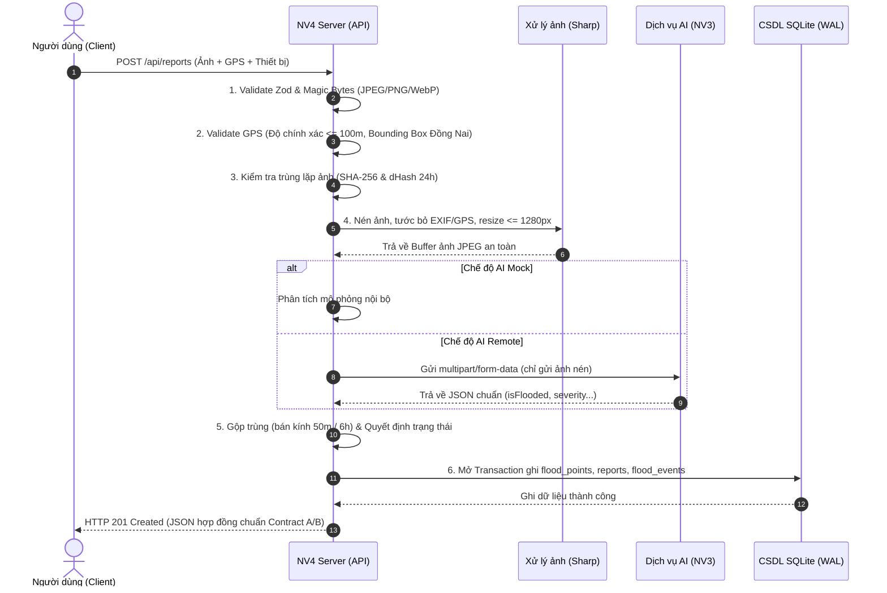

# Tài Liệu Bàn Giao Kỹ Thuật Module NV4 (Báo Cáo Ngập & Xác Thực Cộng Đồng)

Tài liệu này tổng hợp toàn bộ kiến trúc, quy tắc nghiệp vụ, hướng dẫn vận hành, tích hợp liên module và các lưu ý kỹ thuật của Module NV4 thuộc dự án Cảnh báo Ngập lụt Đồng Nai.

---

## 1. Kiến Trúc Hệ Thống NV4

Module NV4 được xây dựng theo kiến trúc phân tầng (Layered Architecture) nhằm đảm bảo tính độc lập, dễ bảo trì và khả năng kiểm thử cao:

```
[ Frontend: Web / Mobile / Leaflet NV1 / Ward NV2 ]
                         │  (HTTP / JSON / GeoJSON / multipart)
                         ▼
             [ src/server.js & Routes ]
                         │
        ┌────────────────┼────────────────┐
        ▼                ▼                ▼
[ reportRoutes ] [ floodPointRoutes ] [ wardRoutes ]
        │                │                │
        ▼                ▼                ▼
[ Controllers & Services (reportService, queryService, confirmationService) ]
        │                │                │
        ├────────────────┼────────────────┤
        ▼                ▼                ▼
  [ src/domain (Logic nghiệp vụ thuần túy: geo, lifecycle, dedupe, trustScore) ]
        │                │                │
        ▼                ▼                ▼
  [ src/repositories (SQLite WAL: floodPointRepo, reportRepo, eventRepo...) ]
```

- **Môi trường & Nền tảng**: Node.js (ES Module), Express 4.x.
- **Cơ sở dữ liệu**: SQLite 3 qua thư viện `better-sqlite3` với chế độ ghi đồng thời `WAL` (Write-Ahead Logging) và ràng buộc khóa ngoại (`foreign_keys = ON`).
- **Domain Layer (`src/domain/`)**: Toàn bộ hàm nghiệp vụ là pure functions (hàm thuần), nhận mốc thời gian `now` làm tham số đầu vào, không gọi `Date.now()` bên trong để đảm bảo khả năng kiểm thử 100%.
- **Xử lý hình ảnh**: Thư viện `sharp` thực hiện kiểm tra `limitInputPixels: 50M`, xóa sạch metadata EXIF/GPS vì quyền riêng tư, thu nhỏ cạnh tối đa 1280px và nén JPEG q80.

---

## 2. Sơ Đồ Luồng Xử Lý Báo Cáo Ngập



---

## 3. Bảng Quy Tắc Nghiệp Vụ Chuẩn (`src/config/rules.js`)

| Nhóm quy tắc | Hằng số quy định | Giá trị | Ý nghĩa nghiệp vụ |
| :--- | :--- | :---: | :--- |
| **Gộp báo cáo trùng** | `DUPLICATE_RADIUS_M` | 50 m | Bán kính xác định 2 báo cáo thuộc cùng 1 điểm ngập |
| | `DUPLICATE_WINDOW_HOURS` | 6 giờ | Cửa sổ thời gian tính từ lần cập nhật gần nhất để gộp điểm |
| **Kiểm tra GPS** | `GPS_MAX_ACCURACY_M` | 100 m | Sai số GPS tối đa cho phép chấp nhận báo cáo |
| | `GPS_WARNING_ACCURACY_M` | 50 m | Ngưỡng cảnh báo GPS có độ chính xác thấp |
| | `REPORT_MAX_AGE_MINUTES` | 5 phút | Thời gian tối đa kể từ lúc chụp ảnh đến lúc gửi |
| | `DONG_NAI_BBOX` | `10.35 - 11.60 Lat`<br>`106.75 - 107.60 Lng` | Bounding Box ranh giới tạm thời tỉnh Đồng Nai |
| **Vòng đời & Xác nhận** | `EXPIRE_AFTER_HOURS` | 6 giờ | Tự động chuyển `expired` nếu không có tương tác mới |
| | `ENDED_CONFIRMATIONS_TO_RESOLVE`| 2 thiết bị | Số thiết bị khác nhau báo 'ended' để chuyển sang 'resolved' |
| | `CONFIRM_MAX_DISTANCE_M` | 300 m | Khoảng cách tối đa từ người xác nhận đến điểm ngập |
| | `PENDING_REPORTS_TO_PROMOTE` | 2 thiết bị | Số báo cáo từ 2 thiết bị để nâng `pending` thành `active` |
| **Tuyến đường hay ngập** | `FLOOD_PRONE_MIN_EVENTS` | 3 sự kiện | Số sự kiện ngập tối thiểu trong 1 năm để đánh dấu hay ngập |
| | `FLOOD_PRONE_WINDOW_DAYS` | 365 ngày | Chu kỳ tính sự kiện ngập lặp lại |
| | `FLOOD_PRONE_CLUSTER_RADIUS_M` | 100 m | Bán kính gom cụm điểm nếu không trùng tên đường |
| **Giới hạn tần suất** | `RATE_LIMIT_REPORTS_PER_HOUR` | 5 báo cáo | Giới hạn cho 1 `deviceId` trong 1 giờ |
| | `RATE_LIMIT_REQUESTS_PER_MINUTE`| 20 requests | Giới hạn theo địa chỉ IP trong 1 phút |
| | `RATE_LIMIT_CONFIRMS_PER_MINUTE`| 10 requests | Giới hạn gửi xác nhận theo địa chỉ IP trong 1 phút |
| **Xử lý ảnh** | `IMAGE_MAX_PIXELS` | 50.000.000 px | Ngưỡng giải nén tối đa cho Sharp chống decompression bomb |
| | `SIMILAR_IMAGE_MAX_HAMMING` | 5 | Khoảng cách Hamming dHash tối đa để coi là ảnh gần trùng |

---

## 4. Hướng Dẫn Vận Hành & Khởi Chạy

Các lệnh vận hành được khai báo chuẩn trong `package.json`:

```bash
# 1. Cài đặt các gói phụ thuộc runtime
npm install

# 2. Khởi tạo cấu trúc bảng CSDL SQLite
npm run migrate

# 3. Nạp dữ liệu mẫu thử nghiệm
npm run seed

# 4. Khởi chạy máy chủ phát triển
npm run dev

# 5. Thiết lập lại dữ liệu Demo cho buổi thuyết trình (12 điểm chuẩn tương đối)
npm run demo:reset

# 6. Kiểm tra toàn diện hệ thống độc lập
npm run verify

# 7. Chạy kiểm thử tự động (Unit & Integration)
npm test
```

---

## 5. Hướng Dẫn Chuyển Đổi Tích Hợp AI (NV3) & Dữ Liệu Thật

### A. Chuyển đổi sang máy chủ AI NV3 thật (`AI_MODE=remote`)
1. Đảm bảo dịch vụ phân tích hình ảnh của NV3 đang chạy (mặc định tại cổng `3001`).
2. Mở file `.env` và cấu hình:
   ```ini
   AI_MODE=remote
   AI_ANALYZE_URL=http://localhost:3001/api/analyze-flood
   AI_API_KEY=your_secret_api_key_here
   AI_TIMEOUT_MS=20000
   ```
3. Khởi động lại server NV4. Hệ thống sẽ tự động gửi ảnh nén sang NV3 qua giao thức HTTP POST multipart, có retry 1 lần khi gặp lỗi mạng/5xx và chuyển fail-safe về trạng thái `pending` nếu AI không phản hồi.

### B. Chuyển đổi sang chế độ Dữ liệu thật (`DATA_MODE=real`)
1. Dọn sạch toàn bộ dữ liệu mẫu demo khỏi CSDL:
   ```bash
   npm run seed:clear
   ```
2. Cập nhật file `.env`:
   ```ini
   DATA_MODE=real
   ```
3. Lưu ý: Khi `DATA_MODE=real`, hệ thống **tuyệt đối cấm** sử dụng `AI_MODE=mock` và cấm chạy lệnh `npm run demo:reset`.

---

## 6. Các Giới Hạn Đã Biết (Known Limitations)

1. **Ranh giới địa lý**: Hiện sử dụng Bounding Box hình chữ nhật của Đồng Nai. Cần module NV6 cung cấp Polygon GeoJSON ranh giới chính xác theo bản đồ hành chính trong tương lai.
2. **Xác định Phường/Xã (`wardId`)**: Hiện sử dụng ánh xạ danh sách từ khóa tuyến đường và khoảng cách centroid tạm thời. Cần tích hợp Geo-reverse indexing từ dữ liệu GIS của NV6.
3. **Lưu trữ ảnh**: Hình ảnh được lưu trên đĩa máy chủ (`uploads/YYYY/MM/<uuid>.jpg`). Khi triển khai phân tán quy mô lớn, cần adapter chuyển sang Object Storage (S3 / MinIO / Cloud Storage).
4. **Bộ nhớ Rate Limiting**: Lưu trữ trạng thái bộ đếm trong RAM của tiến trình Node.js. Sẽ bị reset khi khởi động lại server.
5. **So sánh ảnh gần trùng**: Sử dụng thuật toán `dHash` (difference hash) 64-bit. Hiệu quả cao với ảnh crop/nén nhẹ, nhưng không nhận diện được ảnh chụp cùng góc khác thời điểm sáng/tối.
6. **Địa chỉ PUBLIC_BASE_URL**: Mặc định là `http://localhost:3000`. Khi chạy qua tunnel hoặc domain công khai, cần cập nhật đúng biến `PUBLIC_BASE_URL` để đường dẫn ảnh hiển thị chính xác trên thiết bị di động.

---

## 7. Checklist Kiểm Tra Trước Khi Triển Khai (Production Checklist)

Trước khi chuyển giao máy chủ sang môi trường sản xuất (Production), quản trị viên hệ thống cần rà soát các tiêu chí sau:

- [ ] **Môi trường**: Khai báo `NODE_ENV=production` trong biến môi trường.
- [ ] **Danh sách Origin**: Khai báo danh sách tên miền được phép trong `ALLOWED_ORIGINS` (không được để trống).
- [ ] **Trust Proxy**: Đặt tường minh `TRUST_PROXY=1` (nếu sau Nginx/Cloudflare) hoặc danh sách CIDR tin cậy; không để `false` nếu chạy sau reverse proxy.
- [ ] **Bảo mật thư mục `/integration`**: Tự động trả về 404 trên production.
- [ ] **Chế độ dữ liệu**: Bắt buộc `DATA_MODE=real` và `AI_MODE=remote` (hoặc `local`). Server sẽ từ chối khởi động nếu còn đặt `mock` hoặc `demo`.
- [ ] **Dung lượng lưu trữ**: Thư mục `uploads/` có đủ dung lượng và quyền ghi (khuyến nghị gắn ổ đĩa riêng và giám sát cảnh báo > 80%).
